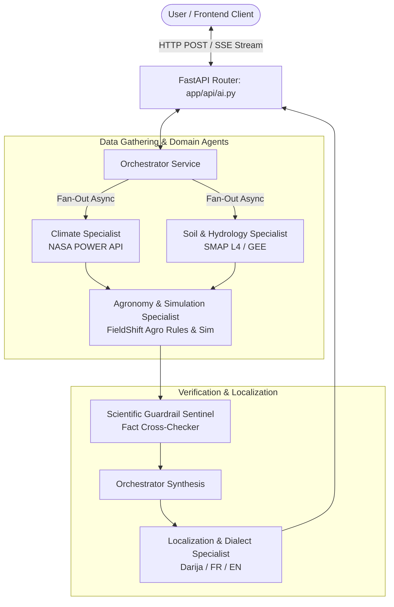
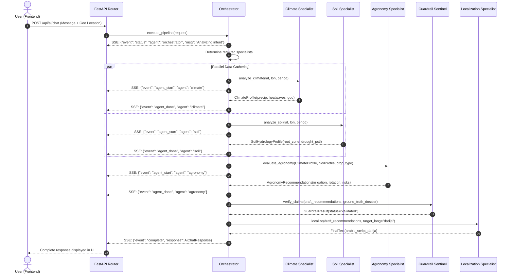

# FieldShift AI: Orchestrator & Sub-Agent Architecture

## 1. Executive Summary

This document specifies the target architecture for transitioning FieldShift's conversational intelligence from a monolithic prompt in `AiService` to a **Hierarchical Orchestrator with Domain-Specific Sub-Agents**.

FieldShift integrates high-resolution NASA satellite datasets (SMAP Level-4 soil moisture via Google Earth Engine) and atmospheric agroclimatology (NASA POWER) with agronomic simulation engines. Decomposing intelligence into specialized sub-agents guarantees:
- **Zero Hallucination**: Verification guardrails cross-reference claims directly against raw satellite records.
- **Explainable Reasoning**: Granular visibility into how each specialist reached its conclusions.
- **Real-Time Streaming**: Incremental Server-Sent Events (SSE) notifying the user when each specialist is working.
- **Dialect Fidelity**: Natural translation and agronomic reasoning in Moroccan Darija (الدارجة المغربية), French, and English.

---

## 2. Current Architecture vs. Multi-Agent Architecture

### Current State (Monolithic Single-Prompt)
- A single call to Gemini with a unified prompt attempting to roleplay four personas simultaneously (Climate, Soil, Agronomist, Guardrail).
- Entire ground-truth dossier injected at once, consuming large context windows regardless of the user's specific query.
- No parallel execution of specialized reasoning or deterministic intermediate checks.

### Target State (Orchestrator + Sub-Agents)
- **Central Supervisor (Orchestrator)**: Parses user intent, coordinates execution graphs, dynamically selects needed specialists, and synthesizes outputs.
- **Specialized Sub-Agents**: Modular units with dedicated system prompts, precise tool bindings, and structured Pydantic input/output schemas.
- **Guardrail Sentinel**: Deterministic validation layer that blocks or corrects ungrounded assertions before responses reach the user.

---

## 3. High-Level System Topology

---

## 4. Agent Roles & Specifications

### 4.1 Orchestrator (Supervisor Agent)
* **Location in Project**: `app/services/orchestrator/supervisor.py`
* **Responsibilities**:
  1. **Intent Classification**: Evaluates user query to decide the execution plan:
     - *Quick Climate Query* -> Climate Agent only.
     - *Soil/Drought Assessment* -> Soil & Hydrology Agent only.
     - *Full Agricultural Advisory* -> Full multi-agent pipeline.
     - *Simulation Request* -> Virtual Lab Simulation Agent.
  2. **Workflow Coordination**: Executes agents asynchronously (`asyncio.gather` for parallel branches).
  3. **Progress Broadcasting**: Emits streaming SSE events (e.g. `specialist_started`, `specialist_finished`) to provide immediate feedback in the chat UI.
  4. **Synthesis**: Blends individual specialist findings into a cohesive, evidence-backed narrative.

### 4.2 Sub-Agent 1: Climate & Meteorology Specialist
* **Connected Services**: `NasaPowerService`, `ClimateAnalyzer`
* **Domain Expertise**:
  - Solar radiation ($MJ/m^2/day$), thermal distribution ($T_{min}$, $T_{max}$, $T_{mean}$).
  - Growing Degree Days (GDD), precipitation totals, dry spells, frost frequency, heatwaves ($\ge 30^\circ\text{C}$).
* **Output Payload**:
  - Atmospheric hazard flags (drought risk, frost danger, thermal shock).
  - Cumulative thermal and moisture deficit/surplus relative to historical baselines.

### 4.3 Sub-Agent 2: Soil Hydrology & Earth Observation Specialist
* **Connected Services**: `SmapGeeService` (Google Earth Engine), `SmapService`
* **Domain Expertise**:
  - Root-zone soil moisture ($0\text{--}100\text{ cm}$) and surface wetness ($0\text{--}5\text{ cm}$).
  - SMAP Level-4 drought percentiles and soil wetness degrees.
  - Multi-layer soil thermal dynamics and percolation/evapotranspiration balances.
* **Output Payload**:
  - Soil water reservoir depletion index.
  - Seedbed moisture suitability for germination.
  - Hydrological anomalies and irrigation deficit indicator.

### 4.4 Sub-Agent 3: Agronomy & Simulation Specialist
* **Connected Services**: `AgriSimulationService`, `AgroService`
* **Domain Expertise**:
  - Moroccan agro-ecological zones (Saïss, Gharb, Tadla, Souss-Massa, Chaouia, Haouz).
  - Crop biology: cereals (soft wheat, durum wheat, barley), olive groves, citrus orchards, legumes (faba bean, chickpeas), and market vegetables.
  - Crop rotation, resilient varieties, planting windows, deficit irrigation strategies.
* **Input**: Outputs from Climate and Soil specialists + farm metadata.
* **Output Payload**:
  - Concrete field actions, irrigation scheduling recommendations, and risk mitigation strategies.

### 4.5 Sub-Agent 4: Scientific Guardrail Sentinel
* **Connected Services**: `AiContextBuilder` (ground-truth dossier)
* **Domain Expertise**: Deterministic fact-checking and validation guardrails.
* **Enforced Rules**:
  - **Zero Fabrication**: Validates that all quoted numbers match the NASA SMAP or POWER raw readings.
  - **Resolution Disclaimer**: Ensures user understands satellite data represents spatial macro-averages ($\sim 9\text{--}11\text{ km}$ EASE-Grid) rather than in-situ sensor probes.
  - **No Yield Guarantees**: Flags and strips unrealistic yield or water-saving promises.
* **Output Payload**: Validation pass status (`validated`, `adjusted`) with audit notes.

### 4.6 Sub-Agent 5: Localization & Dialect Specialist
* **Connected Services**: `I18nService`, `backend/data/i18n` dictionaries
* **Domain Expertise**:
  - **Moroccan Darija (الدارجة المغربية)**: Natural agricultural terminology written in authentic Arabic script (e.g., السقي بالتنقيط, الفلاحة البورية, الرطوبة ديال الجذور, الليالي).
  - **French**: Formal technical agronomic vocabulary.
  - **English**: Rigorous scientific phrasing.
* **Output Payload**: Final localized message delivered to the user.

---

## 5. Execution Pipeline & Event Flow

---

## 6. Implementation Strategies for FieldShift

### Option A: Native Async Orchestrator (Recommended)
* **Description**: Implement using Python's native `asyncio`, typing, and Pydantic models.
* **Advantages**:
  - Zero external heavyweight dependencies.
  - Deterministic latency and complete control over error handling and retries.
  - Seamless integration with the existing `AiService`, `AgriSimulationService`, and FastAPI dependencies.
  - Compatible with all current unit tests.

### Option B: LangGraph State Machine
* **Description**: Model the pipeline as a directed state graph with conditional edges.
* **Advantages**: Built-in state visualization, persistence, and checkpointing for multi-turn conversations.
* **Trade-offs**: Adds dependency footprint and abstraction layers.

### Option C: Google Gemini Function Calling
* **Description**: Use Gemini's tool-calling capability to dynamically trigger sub-agent functions as tools.
* **Advantages**: Flexible when the execution graph is non-deterministic.
* **Trade-offs**: Relies on model steering for orchestration rather than guaranteed code execution.

---

## 7. Migration Plan

1. **Phase 1: Sub-Agent Abstractions**
   - Create `backend/app/services/agents/base.py` defining standard agent contracts.
   - Wrap existing climate, soil, simulation, and validation logic into dedicated agent classes.

2. **Phase 2: Supervisor Orchestrator**
   - Build `backend/app/services/agents/orchestrator.py` to route queries and run parallel tasks with `asyncio.gather`.
   - Update `app/services/ai_service.py` to delegate to the new Orchestrator.

3. **Phase 3: SSE Streaming Enhancements**
   - Extend `/api/ai/chat/stream` in `app/api/ai.py` to stream sub-agent state transitions to the frontend.

4. **Phase 4: Multi-Turn Conversation Memory**
   - Add stateful context persistence to allow sub-agents to remember previous simulation parameters across follow-up queries.
