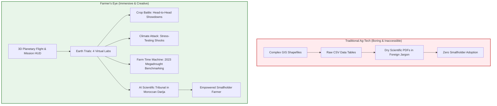
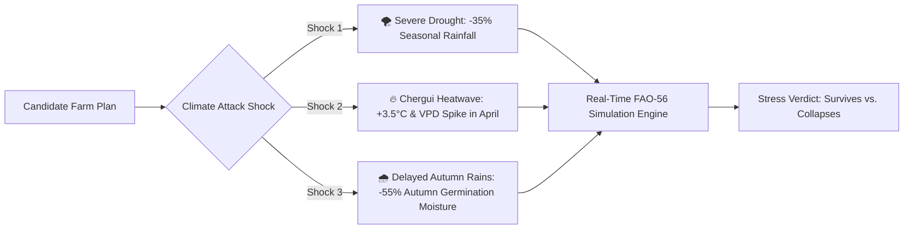
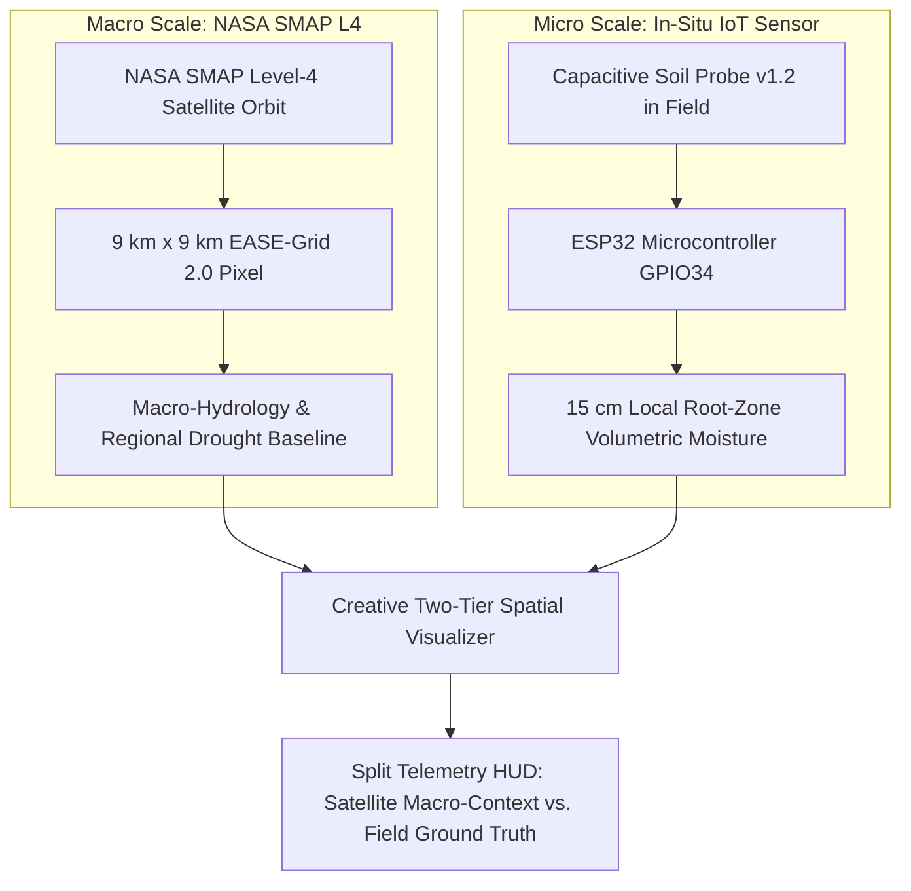

# Farmer's Eye — Evaluation Criterion 2: CREATIVITY
> **Competition:** 2026 NASA Space Apps Challenge  
> **Challenge Track:** *Field Shift: Adapting Farms with NASA Data*  
> **Judging Dimension:** **CREATIVITY & ORIGINALITY** (20% of Global Score)  
> **Live Documentation Portal:** [https://nasa-docs.vercel.app/](https://nasa-docs.vercel.app/)  
> **Status:** ✅ **Revolutionary UX, "Earth Trials" Digital Twin & Vernacular Multi-Agent Deliberation**

---

## 1. The Creative Leap: Escaping the "Spreadsheet Trap"

Traditional precision agriculture software suffers from a fatal user-experience flaw: it is designed by data scientists for enterprise agribusinesses. It bombards users with complex GIS shapefiles, dense numerical CSV tables, obscure spectral band indices ($NDVI$, $EVI$), and dry statistical charts that mean nothing to a family smallholder.

**Farmer's Eye reinvents farm decision support by replacing static reports with "Earth Trials": an interactive, four-laboratory digital twin powered by an autonomous Multi-Agent Scientific Tribunal.**



---

## 2. The 4 Virtual Agricultural Laboratories ("Earth Trials")

Farmer's Eye structures scientific exploration around four creative, gamified virtual laboratories that make NASA Earth science intuitive, tangible, and exhilarating to explore.

```
┌──────────────────────────────────────────────────────────────────────────────────────────────────┐
│                                 THE 4 "EARTH TRIALS" VIRTUAL LABS                                │
├──────────────────────┬──────────────────────────────────────────┬────────────────────────────────┤
│ VIRTUAL LAB          │ INTERACTIVE MECHANIC                     │ SCIENTIFIC PURPOSE             │
├──────────────────────┼──────────────────────────────────────────┼────────────────────────────────┤
│ 1. ⚔️ CROP BATTLE     │ Head-to-head showdown between competing  │ Reveals hidden costs of wheat  │
│                      │ rotations with resilience scoring.       │ monoculture vs. triennale.     │
├──────────────────────┼──────────────────────────────────────────┼────────────────────────────────┤
│ 2. 🌪️ CLIMATE ATTACK  │ One-click acute environmental stress     │ Proves if a rotation survives  │
│                      │ testing: Drought, Chergui, Late Rains.   │ climate shocks before planting.│
├──────────────────────┼──────────────────────────────────────────┼────────────────────────────────┤
│ 3. ⏳ TIME MACHINE   │ Retrospective simulation benchmarking    │ Answers: "Would this plan have │
│                      │ candidate crops against historic 2023.   │ survived the 2023 drought?"    │
├──────────────────────┼──────────────────────────────────────────┼────────────────────────────────┤
│ 4. ⚖️ AI TRIBUNAL    │ Autonomous multi-agent panel debating    │ Provides 360° consensus with   │
│                      │ in authentic Moroccan Darija.            │ scientific guardrail audit.    │
└──────────────────────┴──────────────────────────────────────────┴────────────────────────────────┘
```

### 2.1 ⚔️ Crop Battle Lab: Head-to-Head Agronomic Showdowns
Instead of asking a farmer to read multi-page comparative balance sheets, the **Crop Battle Lab** pits two agricultural strategies against each other in an arena-style showdown:
* **The Contenders:** The farmer's current monoculture habit (*Plan 1: Durum Wheat Monoculture*) versus the proposed climate-adapted alternative (*Plan 2: Resilient Triennale*).
* **The Visual Showdown:** Visual circular meters, color-coded health gauges, and side-by-side metric comparison cards evaluate:
  * Cumulative Atmospheric Water Demand ($ET_c$).
  * Maximum Root-Zone Water Deficit ($D_r$).
  * Severe Drought Stress Days ($D_r > RAW$).
  * Biological Nitrogen Capital & Synthetic Fertilizer Cost.
  * Fungal Pathogen Exposure Index.
* **The Outcome:** The system computes a composite **Resilience Score** ($0\text{--}100$) showing immediate, unambiguous superiority (e.g., $38/100$ vs. $82/100$).

### 2.2 🌪️ Climate Attack Lab: One-Click Acute Stress Testing
Farmers fear the unknown. Farmer's Eye lets them subject their candidate crop rotations to simulated extreme weather shocks with a single click before sowing a single seed:



1. **Severe Drought Shock ($-35\%$ rainfall):** Multiplies daily NASA precipitation time series by $0.65$. Shows the farmer whether the legume or early barley rotation preserves enough subsoil moisture to prevent terminal wilting.
2. **Chergui Heatwave Shock ($+3.5^\circ\text{C}$ & $VPD$ spike in April):** Simulates scorching easterly desert winds during the critical cereal flowering stage. The system demonstrates why early-maturing six-row barley survives by completing grain filling prior to the heatwave.
3. **Late Rains Shock ($-55\%$ autumn rain):** Tests seedbed establishment when the rainy season is delayed to December. Validates deep-sowing legume resilience versus shallow-sown wheat vulnerability.

### 2.3 ⏳ Farm Time Machine: Historical Megadrought Benchmarking
Rather than relying on abstract future probabilistic projections for the year 2050, the **Farm Time Machine** anchors climate reality in the farmer's own lived memory:
* **The Reference Event:** The catastrophic 2022–2023 Moroccan drought (the driest year in 40 years, with only $273.4\text{ mm}$ of precipitation in Saïss and $159$ days above $25^\circ\text{C}$).
* **The Retrospective Simulation:** The Farm Time Machine runs the farmer's candidate rotation through the actual daily weather records of the 2022–2023 season.
* **The Question Answered:** *"If you had planted this Resilient Triennale rotation during the disastrous 2023 season, would you have lost your farm?"* The simulation displays the exact day-by-day soil moisture trajectory and proves that the diversified rotation would have salvaged grain and straw while monoculture suffered $100\%$ failure.

### 2.4 ⚖️ AI Scientific Tribunal: Multi-Agent Consensus Debate
Instead of a generic chatbot that spews flat paragraphs, Farmer's Eye stages an **autonomous multi-agent courtroom debate**:
* Multiple specialized AI agents (Climate Specialist, Soil Hydrologist, Agronomist, and Guardrail Sentinel) cross-examine the candidate rotation from their respective disciplines.
* The user witnesses the agents "deliberating" in real time, exposing trade-offs, soil moisture constraints, and nitrogen balances before arriving at a unanimous scientific verdict.

---

## 3. Creative Cultural Grounding: Moroccan Darija & 3D Avatar

### 3.1 Authentic Agronomic Moroccan Darija (الدارجة المغربية الفلاحية)
Artificial intelligence in the Arab world has historically been trained on Formal Modern Standard Arabic (فصحى), creating an intimidating linguistic barrier for rural smallholders. Farmer's Eye breaks this paradigm:
* The AI engine reasons directly in authentic **Moroccan Darija** using the exact colloquial agricultural lexicon:
  * **الفلاحة البورية (*L-Bour*):** Traditional dryland farming reliant exclusively on rainfall.
  * **رياح الشرقي (*Chergui*):** Hot, dry easterly continental desert winds that dehydrate crops.
  * **الترس والحمري (*Tir* and *Hamri*):** Traditional classification of rich black vertisols and red clay loam soils.
  * **السقي الموضعي بالتنقيط (*Sqi b-tnqit*):** Local term for drip micro-irrigation.
* The interface features Cairo Arabic typography with native right-to-left (RTL) ergonomics, creating an immediate sense of trust and cultural belonging.

### 3.2 3D Interactive Agronomist Avatar
On the hero dashboard, an animated 3D Agronomist mascot welcomes the farmer with reactive speech bubbles, guiding them step-by-step through farm coordinate selection, crop rotation simulation, and laboratory stress testing.

---

## 4. Visualizing the Invisible: Two-Tier Spatial Fusion



A common pitfall in satellite data applications is misleading users into believing a $9\text{ km}$ satellite pixel represents their specific 1-hectare parcel. Farmer's Eye solves this creatively:
* **The Two-Tier Telemetry HUD:** The user interface explicitly separates regional satellite context ($9\text{ km}$ NASA SMAP L4 macro-cell) from point-level field reality ($15\text{ cm}$ in-situ capacitive sensor probe).
* Both values are displayed side-by-side with transparent spatial confidence indicators, educating the farmer on how satellite macro-trends correlate with their local soil wetness without any deception.

---

## 5. Summary of Creative Innovations

1. **Gamified "Earth Trials":** Transforms agricultural hydrology into engaging scientific laboratories (Crop Battle, Climate Attack, Time Machine).
2. **Autonomous Multi-Agent Deliberation:** Replaces static advice with an interactive scientific tribunal.
3. **Dialectal Inclusivity:** First agricultural intelligence platform fluent in Moroccan Darija farming vernacular.
4. **Cinematic 3D Mission Control:** High-performance MapLibre planetary globe with parabolic van Wijk camera descents.
5. **Creative Spatial Honesty:** Clear visual demarcation between macro-orbital Earth observations and micro-in-situ field measurements.
