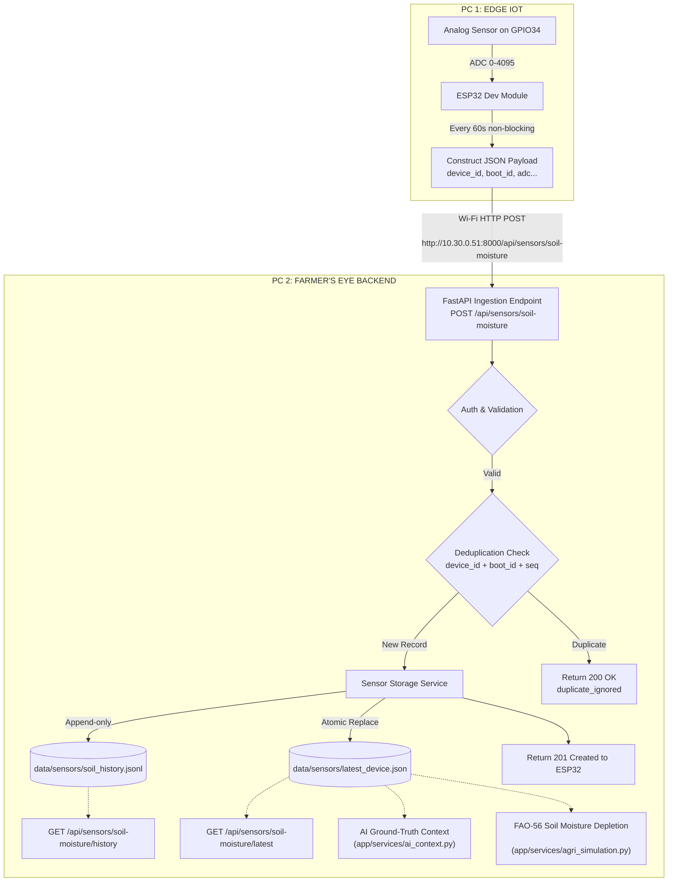

# Technical Architecture Analysis & Implementation Plan
## Farmer's Eye: ESP32 Soil Sensor Integration

---

## Part 1 — Current Architecture

### 1. Backend Framework & Runtime
* **Framework**: **FastAPI** (`>=0.115.6`), running on **Python 3.10+** (referenced in `backend/requirements.txt`).
* **ASGI Server**: **Uvicorn** (`>=0.34.0`) (referenced in `backend/requirements.txt`).
* **Execution & Lifespan**: Initialized in `backend/app/main.py` with an `asynccontextmanager` (`lifespan`) managing shared state (`app.state.settings`, `app.state.climate_service`, `app.state.smap_gee_service`, `app.state.ai_service`, etc.).
* **Data Validation & Settings**: **Pydantic v2** (`>=2.10.6`) and **Pydantic-Settings** (`>=2.7.1`) configured in `backend/app/core/config.py`.

### 2. HTTP Server & Port Configuration
* In `backend/app/main.py` (lines 194–203):
  ```python
  if __name__ == "__main__":
      uvicorn.run("app.main:app", host="127.0.0.1", port=8000, reload=True, reload_dirs=["app"])
  ```
* **Active Port Status**: Verified via live socket inspection (`netstat -ano`). Uvicorn is currently listening on port `8000`, bound to loopback address `127.0.0.1:8000`.
* **Host PC 2 Network Configuration**: Verified via `ipconfig`. PC 2 has an active local Wi-Fi adapter IPv4 address `10.30.0.51` on subnet `255.255.255.0` (Gateway: `10.30.0.1`).

### 3. API Routers & Routing Conventions
API routes follow a structured FastAPI `APIRouter` pattern registered in `backend/app/main.py`:
* `/api/climate` (`backend/app/api/climate.py`)
* `/api/smap` (`backend/app/api/smap.py`)
* `/api/smap-gee` (`backend/app/api/smap_gee.py`)
* `/api/agro` (`backend/app/api/agro.py`)
* `/api/ai` (`backend/app/api/ai.py`)
* `/api/catalogue` (`backend/app/api/catalogue.py`)
* `/api/i18n` (`backend/app/api/i18n.py`)
* Error responses use standardized models (`ErrorResponse` in `backend/app/models/climate.py`) across all endpoints.

### 4. Database & Persistent Storage Mechanisms
* **No SQL / NoSQL Database**: There is **no database engine configured or installed** in the repository (no SQLAlchemy, PostgreSQL, MongoDB, or SQLite ORM in `requirements.txt`).
* **Existing Storage Infrastructure**: The project relies on an atomic file-based persistence strategy managed by `FileCache` in `backend/app/services/cache.py`.
  * Storage root defaults to `backend/data/` (configured via `Settings.cache_dir` in `backend/app/core/config.py`).
  * Existing subdirectories: `data/raw/`, `data/processed/`, `data/geocode/`, `data/smap/`, `data/smap_gee/`, `data/i18n/`.
  * Atomic writes are implemented via temporary files: writing to `.tmp` and replacing the destination with `temporary.replace(path)` (`cache.py` lines 297–308).

### 5. Dependency Injection Architecture
* Centralized factory functions and request dependencies reside in `backend/app/api/deps.py`, where singletons created during lifespan are injected into route handlers using `Depends()`.

### 6. Existing Sensor / Telemetry Modules
* **No physical sensor ingestion exists yet**.
* Satellite models in `ai_service.py` (line 41) and `smap_gee.py` (line 339) explicitly document:
  > *"Scientific notice: Assimilated NASA SMAP L4 and POWER observations on a ~9-11 km grid, not direct in-situ sensor probes."*
  > *"Reported irrigation savings are derived from FAO-56 depletion trigger model, as on-farm flowmeter or telemetry data are unverified."*
* The incoming ESP32 data will directly fill this gap by providing verified in-situ soil moisture ground truth.

---

## Part 2 — Integration Feasibility

**Conclusion**: **Yes**, the ESP32 can send JSON measurements directly to the existing backend over Wi-Fi via HTTP POST, but **two network/server configuration prerequisites must be addressed**:

1. **Server Bind Address (`host="0.0.0.0"`)**:
   - Currently, `backend/app/main.py` binds Uvicorn to `127.0.0.1`.
   - `127.0.0.1` listens exclusively to local loopback traffic on PC 2. External devices on the Wi-Fi network (such as the ESP32 on PC 1) will encounter a connection timeout or refused socket.
   - **Resolution**: Uvicorn must be launched listening on `0.0.0.0` (all network interfaces) so it can accept incoming connections directed to PC 2's LAN IP (`10.30.0.51:8000`).

2. **Windows Defender Firewall on PC 2**:
   - By default, Windows Firewall blocks incoming TCP connections on non-standard ports (such as 8000) from other subnet clients on the local network.
   - **Resolution**: An inbound rule must allow TCP traffic on port `8000` for the private local network profile on PC 2.

3. **HTTP Protocol Compatibility**:
   - The ESP32's `HTTPClient` library natively supports HTTP/1.1 `POST` with `Content-Type: application/json`, matching FastAPI's request validation.
   - Pushing data from ESP32 to PC 2 avoids having the backend continuously poll the battery/microcontroller-powered ESP32, which is the standard, robust architecture for IoT edge nodes.

---

## Part 3 — Recommended Data Flow



---

## Part 4 — Backend Integration Plan

To maintain modularity and respect the project's existing structure, the following additions and modifications are planned:

### New Components (To be created when authorized)
1. **`backend/app/models/sensor.py`**:
   - Pydantic models for incoming telemetry payload (`SoilMoistureIngestRequest`), historical entry with server metadata (`SoilMoistureRecord`), query filter parameters, and API response wrappers (`SensorHistoryResponse`, `SensorLatestResponse`).
2. **`backend/app/services/sensor_service.py`**:
   - Dedicated business logic handling validation, server UTC timestamping, deduplication, appending to persistent storage, and querying historical/latest data.
3. **`backend/app/api/sensors.py`**:
   - FastAPI `APIRouter(prefix="/api/sensors", tags=["sensors"])` exposing ingestion, latest measurement, and historical queries.

### Existing Files Requiring Minimal, Controlled Edits
1. **`backend/app/core/config.py`**:
   - Add sensor configuration fields to `Settings` (e.g., `sensor_api_key: str | None = None`, `sensor_data_dir: Path = Path("data/sensors")`, `sensor_max_history_records: int = 50000`).
2. **`backend/app/api/deps.py`**:
   - Add factory `build_sensor_service(settings)` and dependency `get_sensor_service(request)`.
3. **`backend/app/main.py`**:
   - Initialize `app.state.sensor_service` in `lifespan`.
   - Register `app.include_router(sensors_router)`.
   - Update server startup configuration to bind to `0.0.0.0`.
4. **`backend/app/services/ai_context.py`**:
   - Inject the latest in-situ sensor readings into the AI ground-truth dossier (`AiContextBuilder`), allowing FieldShift AI to compare coarse SMAP satellite root-zone moisture (~9-11 km) with actual real-time probe readings.

---

## Part 5 — Data Model & JSON Contract

### 1. Ingestion Payload Contract (ESP32 $\rightarrow$ Backend)
The incoming payload extends the ESP32's current schema with a unique hardware identifier (`device_id`) and boot cycle identifier (`boot_id`) to ensure reliable sequence tracking:

```json
{
  "device_id": "esp32-soil-01",
  "boot_id": "a4f89c10",
  "mesure_numero": 18,
  "adc": 1222,
  "adc_min": 1205,
  "adc_max": 1243,
  "tension_mv": 1144,
  "humidite_relative_pct": null,
  "etat": "NON CALIBRE",
  "calibre": false,
  "reference_sec": -1,
  "reference_humide": -1,
  "uptime_sec": 93,
  "wifi_rssi_dbm": -55
}
```

* **Validation Rules**:
  - `device_id`: Required string (1–64 characters, alphanumeric and hyphens).
  - `boot_id`: Required string (generated upon ESP32 boot, prevents sequence collision after restarts).
  - `mesure_numero`: Integer $\ge 0$.
  - `adc`: Integer between $0$ and $4095$.
  - `tension_mv`: Float or integer $\ge 0$.
  - `humidite_relative_pct`: **Optional `float | None`**. Validated as `0.0 <= val <= 100.0` if provided; strictly preserved as `null` if uncalibrated.
  - `calibre`: Boolean flag.

### 2. Historical Storage Record Contract (Backend Storage)
When ingested, the backend wraps the reading with immutable server-side metadata:

```json
{
  "record_id": "rec_01JCT95Z8K9W2B1X4Y8M9V0E3A",
  "received_at": "2026-11-15T06:45:00.123456Z",
  "device_id": "esp32-soil-01",
  "boot_id": "a4f89c10",
  "mesure_numero": 18,
  "adc": 1222,
  "adc_min": 1205,
  "adc_max": 1243,
  "tension_mv": 1144,
  "humidite_relative_pct": null,
  "etat": "NON CALIBRE",
  "calibre": false,
  "reference_sec": -1,
  "reference_humide": -1,
  "uptime_sec": 93,
  "wifi_rssi_dbm": -55
}
```

### 3. Persistent Storage Engine Evaluation

| Storage Option | Evaluation for Current Codebase | Recommendation |
| :--- | :--- | :--- |
| **Option A: External Relational DB (PostgreSQL / MySQL)** | **Not recommended**: No database or ORM exists in `requirements.txt`. Would introduce heavy external setup and break local zero-config portability. | ❌ Reject |
| **Option B: JSON Lines (`.jsonl`) File Storage** | **Highly Recommended**: Fits the existing `data/` caching architecture perfectly.<br>• Every record is appended as a single line (`append-only`).<br>• Fast append ($O(1)$) with zero risk of file corruption during power failures.<br>• Clean streaming reads for queries.<br>• Companion `latest_<device_id>.json` updated atomically via `.tmp.replace()` for instant $O(1)$ status retrieval. | ✅ **Recommended Primary Strategy** |
| **Option C: Embedded SQLite (`data/sensors.db`)** | **Viable Alternative**: Standard Python `sqlite3` requires zero external packages.<br>• Provides built-in SQL indexing on `(device_id, received_at)`.<br>• Good if historical records exceed hundreds of thousands. | ⚠️ Secondary Option |

---

## Part 6 — API Design

The proposed router `app/api/sensors.py` will expose four standardized endpoints:

### 1. Ingestion Endpoint
* **Route**: `POST /api/sensors/soil-moisture`
* **Headers**:
  * `Content-Type: application/json`
  * `X-Sensor-Key: <token>` *(Optional/Configurable via `.env`)*
* **Request Body**: `SoilMoistureIngestRequest`
* **Responses**:
  * `201 Created`:
    ```json
    {
      "status": "success",
      "message": "Measurement recorded",
      "record_id": "rec_01JCT95Z8K9W2B1X4Y8M9V0E3A",
      "received_at": "2026-11-15T06:45:00.123456Z"
    }
    ```
  * `200 OK` *(Duplicate ignored)*:
    ```json
    {
      "status": "duplicate_ignored",
      "message": "Measurement already ingested",
      "record_id": "rec_01JCT95Z8K9W2B1X4Y8M9V0E3A"
    }
    ```
  * `422 Unprocessable Entity`: Validation error (e.g. ADC out of range $0\text{--}4095$).
  * `401 Unauthorized`: Missing or invalid `X-Sensor-Key` (if enabled).

### 2. Latest Measurement Endpoint
* **Route**: `GET /api/sensors/soil-moisture/latest`
* **Query Parameters**:
  * `device_id: str | None = None` *(Defaults to primary active device if omitted)*
* **Responses**:
  * `200 OK`: Returns the single latest `SoilMoistureRecord` with status and elapsed time since last contact.
  * `404 Not Found`: No measurements recorded yet for the requested device.

### 3. Historical Measurements Endpoint
* **Route**: `GET /api/sensors/soil-moisture/history`
* **Query Parameters**:
  * `device_id: str | None = None`
  * `start_time: datetime | None = None` (ISO 8601 UTC)
  * `end_time: datetime | None = None` (ISO 8601 UTC)
  * `limit: int = 100` (min: 1, max: 1000, default: 100)
  * `order: str = "desc"` (`"desc"` for newest first, `"asc"` for chronological)
* **Response `200 OK`**:
  ```json
  {
    "device_id": "esp32-soil-01",
    "total_matching": 420,
    "limit": 100,
    "records": [
      {
        "record_id": "rec_01JCT95Z8K9W2B1X4Y8M9V0E3A",
        "received_at": "2026-11-15T06:45:00.123456Z",
        "adc": 1222,
        "tension_mv": 1144,
        "humidite_relative_pct": null,
        "etat": "NON CALIBRE"
      }
    ]
  }
  ```

### 4. Sensor Telemetry Health Endpoint
* **Route**: `GET /api/sensors/health`
* **Response `200 OK`**:
  ```json
  {
    "status": "healthy",
    "active_devices": ["esp32-soil-01"],
    "total_records_stored": 1440,
    "storage_backend": "json_lines",
    "storage_file": "data/sensors/soil_history.jsonl",
    "storage_writable": true
  }
  ```

---

## Part 7 — ESP32 Changes (Firmware Architecture)

No code is written in this turn, but the firmware modifications required on PC 1 in the Arduino IDE include:

1. **Target Server Configuration**:
   - Replace local loopback with PC 2's LAN address:
     `const char* server_url = "http://10.30.0.51:8000/api/sensors/soil-moisture";`
2. **Stable Identifiers Generation**:
   - `device_id`: Constant string or derived from ESP32 MAC address (`WiFi.macAddress()`).
   - `boot_id`: Random hex string generated once during `setup()` to differentiate boots and counter resets.
3. **Non-Blocking Ingestion Timer**:
   - Replace blocking `delay(60000)` with `millis()` state timing so Wi-Fi background tasks, watchdog timers, and sensor sampling remain responsive.
4. **HTTP Client POST Workflow**:
   - Initialize `WiFiClient` and `HTTPClient`.
   - Set timeout (`http.setTimeout(5000)`).
   - Set headers:
     - `http.addHeader("Content-Type", "application/json");`
     - `http.addHeader("X-Sensor-Key", SENSOR_KEY);` *(if enabled)*
   - Execute `int httpCode = http.POST(jsonBuffer);`.
5. **Acknowledgment & Exponential Backoff Retry**:
   - If HTTP code is `200` or `201`: Transmission succeeded. Increment `mesure_numero`.
   - If Wi-Fi is disconnected or HTTP code is negative / 5xx:
     - Log failure over Serial.
     - Retain current reading in a single-element fallback buffer.
     - Trigger immediate reconnect if `WiFi.status() != WL_CONNECTED`.
     - Retry with exponential backoff (e.g., retry after 5s, 15s, then wait for the next 60s cycle) without blocking the board.

---

## Part 8 — Reliability & Security

### 1. Data Integrity & Overwrite Prevention
* **Append-Only File Strategy**: Historical records are appended to `data/sensors/soil_history.jsonl` using Python's standard `open(file, mode="a", encoding="utf-8")`. In append mode, operating systems guarantee that existing bytes are never overwritten or truncated.
* **Atomic Latest Cache**: When updating `latest_<device_id>.json`, use the project's existing `FileCache` convention: write to `.tmp` first, then atomically rename via `replace()`. This prevents readers from ever seeing partial JSON.

### 2. Deduplication Strategy
* If the ESP32 retries sending a measurement because an ACK packet was dropped on the Wi-Fi network, the backend uses a composite deduplication key:
  $$\text{Deduplication Key} = (\text{device\_id}, \text{boot\_id}, \text{mesure\_numero})$$
* An in-memory cache (e.g., last 50 seen keys) checks incoming payloads. If a match is detected, the backend returns `200 OK` (duplicate acknowledged) without appending a duplicate record to disk.

### 3. Timestamp Authority
* The ESP32's `uptime_sec` can drift and resets on reboot.
* The authoritative timestamp is generated strictly on PC 2 upon arrival using `datetime.now(timezone.utc).isoformat()`.

### 4. Security & Network Boundary
* **Lightweight Header Authentication**: Requests include an `X-Sensor-Key` header matching `Settings.sensor_api_key` in `.env`. Requests without a valid key are rejected with `401 Unauthorized`.
* **CORS & Local Subnet Isolation**: Ingestion is restricted to the local network; the backend is not exposed to the public internet.

---

## Part 9 — Step-by-Step Implementation Roadmap

When authorized to proceed with implementation, execute in this precise order:

### Phase 1: Local Network & Server Binding (PC 2)
1. **Firewall Rule**: Add an inbound rule on PC 2 Windows Defender Firewall allowing incoming TCP port `8000` from the private network.
2. **Uvicorn Bind**: Configure Uvicorn to listen on `0.0.0.0` (all interfaces) rather than `127.0.0.1`.
3. **Connectivity Verification**: Ping PC 2 (`10.30.0.51`) from PC 1, and verify `http://10.30.0.51:8000/health` is reachable from PC 1's browser.

### Phase 2: Backend Models & Storage Service (PC 2)
1. **Config & Models**: Define `SoilMoistureIngestRequest` and `SoilMoistureRecord` in `backend/app/models/sensor.py`.
2. **Storage Service**: Implement `SensorService` in `backend/app/services/sensor_service.py` with append-only `.jsonl` logging and atomic latest state caching under `backend/data/sensors/`.
3. **Dependency Wiring**: Register `build_sensor_service` in `backend/app/api/deps.py`.

### Phase 3: API Router Implementation (PC 2)
1. **Create Router**: Implement `backend/app/api/sensors.py` with `/api/sensors/soil-moisture` (POST), `/latest` (GET), and `/history` (GET).
2. **Register Router**: Include the router in `backend/app/main.py`.
3. **Automated Tests**: Add unit tests in `backend/tests/test_sensors.py` covering validation, null humidity handling, deduplication, and file appending.

### Phase 4: ESP32 Firmware Update (PC 1)
1. **Endpoint Target**: Point the ESP32 code to `http://10.30.0.51:8000/api/sensors/soil-moisture`.
2. **Payload Adjustment**: Add `device_id` and random `boot_id` to the outgoing JSON.
3. **HTTP POST Loop**: Implement non-blocking 60-second POST transmission with response code verification.

### Phase 5: End-to-End Validation & Feature Integration
1. **Live Ingestion Test**: Let the ESP32 transmit for 10 minutes (10 measurements). Verify all 10 appear sequentially in `data/sensors/soil_history.jsonl` with no data loss.
2. **Reboot Test**: Power cycle the ESP32. Verify `boot_id` changes, counter resets, and the backend continues appending without error.
3. **Downstream Integration**: Connect `SensorService.get_latest_measurement()` into `AiContextBuilder` (`backend/app/services/ai_context.py`) so FieldShift AI can correlate real-time in-situ soil readings with NASA SMAP Level-4 satellite observations.

---

## Part 10 — Final Recommendation

* **Storage Choice**: Use **JSON Lines (`data/sensors/soil_history.jsonl`)** alongside an atomic **latest cache (`data/sensors/latest_<device_id>.json`)**. This is the cleanest, zero-dependency solution that perfectly matches this project's existing `FileCache` patterns.
* **Network Strategy**: Bind Uvicorn to `0.0.0.0:8000` on PC 2 and allow inbound port 8000 in Windows Firewall.
* **Sensor Calibration Decoupling**: Keep `humidite_relative_pct` nullable as planned. The backend will faithfully record raw ADC readings and voltage until field calibration curves are established.
