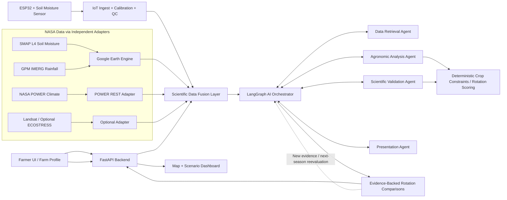
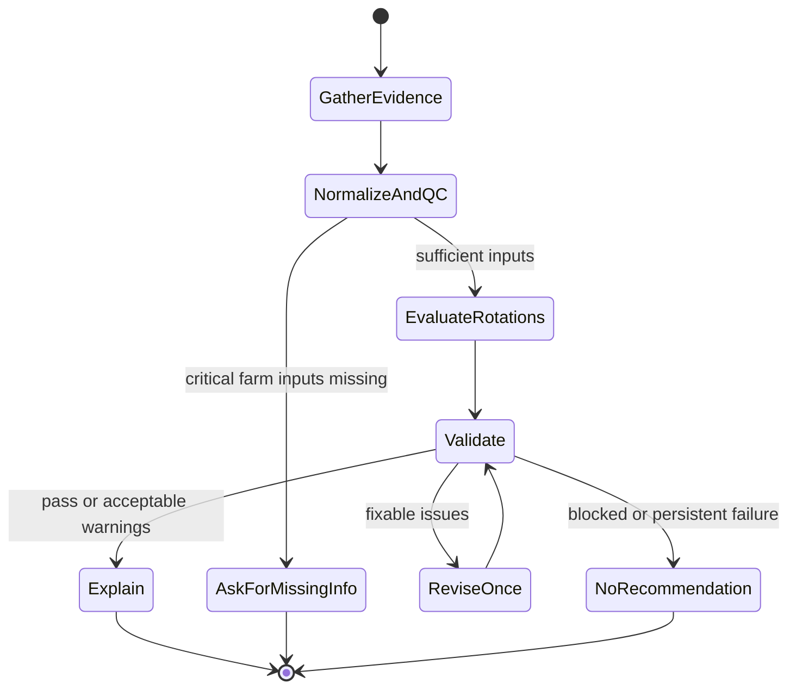

# FieldShift AI — Master Project Context & Implementation Blueprint

> **Audience:** AI coding agents, system architects, frontend/backend developers, data scientists, judges, and the hackathon team.  
> **Document date:** November 14, 2026  
> **Status:** Design blueprint; not a claim that the features below have been implemented.  
> **Retrieval decision (November 14, 2026):** Google Earth Engine replaces NASA Harmony for SMAP L4 and GPM IMERG. NASA POWER stays on its own REST adapter.  
> **Preferred working language:** English for code, APIs and technical documentation; farmer-facing UI may later support Arabic, French, and English.

---

## 0. Instructions to the AI Implementation Agent

You are acting as a senior full-stack engineer, geospatial data engineer, applied agricultural data scientist, and multi-agent AI architect for **FieldShift AI**, a 2026 NASA Space Apps Challenge project. Your primary obligation is to build a **scientifically defensible, demonstrable crop-rotation decision-support MVP** using real NASA Earth observation data and optionally real local IoT sensor readings. 

**Non-negotiable instructions:**

1. **Read this file first** and use it as the single working project brief. Distinguish confirmed facts from open design decisions.
2. **Do not invent satellite observations, farm measurements, weather readings, calculated benefits, agricultural citations, or sensor precision.** Use `null`, `unavailable`, a clearly labeled demo fixture, or an explicit assumption instead.
3. Keep **LLMs out of authoritative numerical calculations**. Use deterministic, testable code for unit conversion, crop constraints, scoring, data validation, and uncertainty flags. LLMs may coordinate tools, assemble structured findings, and explain results.
4. Do not assert that Google Earth Engine improves the native spatial resolution of SMAP. A point sample, `reduceRegion`, or reprojection does not create a new field-scale measurement.
5. **Google Earth Engine is the retrieval path for confirmed SMAP and GPM collections only** (`NASA_SMAP_SPL4SMGP_008` and the verified IMERG V07 asset). NASA POWER keeps its own REST adapter. Do not route ESP32 data or unverified products through Earth Engine by assumption.
6. Do not directly equate an uncalibrated ESP32 sensor ADC percentage with volumetric water content. Record calibration status, sensor depth, soil type, timestamp, and units.
7. Show source provenance, time range, spatial scale, data quality, and uncertainty next to every major recommendation. Do not use invented confidence percentages.
8. If data is unavailable, degrade gracefully; do not silently substitute fake data. A real cached dataset is acceptable if its source/date are visible. Synthetic demo mode must be visually unmistakable.
9. **Prioritize a working end-to-end flow over a large number of features or agents.** Four conceptual specialist agents are sufficient. A separate deterministic scientific engine and data-fusion layer are more important than having many chat agents.
10. Before making implementation choices beyond this spec, inspect the repository and preserve existing working code. Keep an implementation log, tests, and README with reproducible setup instructions.

### Definition of done for the MVP

A user can select a specific farm location (real GPS coordinates or map point), enter farm constraints, see **at least one actual NASA-derived observation**, optionally view live or recorded calibrated ESP32 sensor readings, compare **at least three crop-rotation scenarios including a baseline**, and understand how constraints and evidence lead to the displayed ranking. Every data tile shows its origin; missing evidence triggers a visible warning. The demo works reliably using an intentionally cached real NASA dataset if live external access fails.

---

## 1. Challenge, Mission, and Product Positioning

**Challenge:** NASA Space Apps Challenge 2026 — *Field Shift: Adapting Farms with NASA Data*.  
**Official challenge:** https://www.spaceappschallenge.org/2026/challenges/field-shift-adapting-farms-with-nasa-data/  
**Original resources link:** https://www.spaceappschallenge.org/2026/challenges/adapting-farms-with-nasa-data/?tab=resources (check redirect/availability).  
**Hackathon event dates:** November 14–15, 2026 (verify local submission deadline).  
**Working product name:** FieldShift AI.  
**Tagline:** *Adaptive Crop Rotation with NASA Data + Local IoT.*

### Official problem in our own words

Farmers face changing rainfall, temperatures, water shortages, and declining soil resilience. They need to explore feasible **crop rotation strategies**, considering NASA Earth observations, local soil conditions, crop needs, and personal priorities. The project must explicitly solve a *farm decision* problem, not merely display a satellite dashboard.

### Core problem statement / problématique

> **How can we transform coarse regional NASA Earth observations and locally measured farm conditions into personalized, explainable, scientifically checked, and adaptive crop-rotation strategies under changing climate and water availability?**

### Product thesis

NASA datasets provide the **regional environmental context**; the farm profile and optional **ESP32 soil moisture sensor** provide **local evidence**; a transparent agronomic decision engine evaluates rotation alternatives; an AI orchestrator coordinates specialized tools and communicates the evidence. As conditions change, the tool can re-evaluate the next-season plan, rather than treating an initial recommendation as permanently correct.

### Competitive differentiation

- Not merely “ChatGPT suggests crops.”
- **Satellite + local sensor + farmer constraints** rather than one undifferentiated source.
- Explicit distinction between **coarse regional estimates** and **point measurements**.
- **Crop-rotation scenario comparison** instead of a single unsupported crop suggestion.
- A **scientific validation gate** with traceability, error handling, and the ability to withhold a result.
- **What-if drought/water scenarios** using clearly specified assumptions.
- **Adaptive update loop**: new sensor observations and updated NASA products may change alert status or trigger a new next-season assessment; do not recommend replacing an already planted crop immediately.

### Judging criteria to address

| Criterion | Evidence we should demonstrate |
|---|---|
| Impact | Practical, constraint-aware choices for farmers; estimated water trade-offs (not unverified yield claims). |
| Creativity | NASA observations + real IoT + deterministic agronomy + explainable multi-agent coordination. |
| Validity | Real NASA data, valid units, spatial awareness, source citations, tests, transparent uncertainty. |
| Relevance | Crop rotations, soil health, farmer priorities, drought adaptation as the central features. |
| Presentation | Simple farmer story, clean architecture, maps, live sensor demo, short comparative results. |

---

## 2. Decisions Already Made vs. Decisions Still Open

### Confirmed by the team conversation

- Competition/challenge: 2026 NASA Space Apps, Field Shift.
- Multi-agent orchestrator is a key element of the concept.
- Main desired outputs: adaptive crop-rotation planning, drought resilience, water-efficiency insights, what-if scenarios, and an accessible dashboard.
- **Physical ESP32 and soil moisture sensor are already owned.** Their exact model, sensor output type, depth, calibration, and connectivity remain **unknown**.
- SMAP soil-moisture data and GPM rainfall data are priority research sources.
- **Google Earth Engine replaces NASA Harmony** for location-specific extraction of supported SMAP L4 and GPM IMERG collections. Earth Engine does not increase native resolution.
- The architecture graphics so far are conceptual; the image is not evidence that code exists.

### Recommended, NOT yet user-confirmed

- Geographic pilot: **one drought-prone agricultural region in Morocco**, with an actual farm point or test plot identified. Morocco is a proposal, not a confirmed target.
- Example crop set: wheat, barley, and chickpea, after local agronomic review (not automatically suitable for every area).
- Python + FastAPI backend; React + Tailwind frontend; LangGraph orchestration; PostgreSQL/PostGIS optional (SQLite can serve MVP); `earthengine-api` for SMAP and GPM; NASA POWER over open REST.
- French/Arabic/English as future UI languages.
- Wi-Fi communication from ESP32; MQTT or HTTPS ingestion depending on hardware and team capability.

### Essential open decisions (keep configurable)

1. Specific geographic target and coordinates/polygon; farmland size and test location.
2. Soil sensor model, capacitance/resistance, analog/digital output, calibration, voltage, depth; whether it outputs credible VWC in m³/m³.
3. Exact crop set, crop calendars, soil constraints, and local agricultural references.
4. Team size, available hardware/connectivity, actual hackathon time budget.
5. Whether Earth Engine requests can be completed with the team’s Google Earth Engine credentials, project, and the collection’s published bands.

**If unresolved, implement a configurable pilot and document assumptions rather than hardcoding a fictional “real farm.”**

---

## 3. End-to-End Architecture

### 3.1 Logical architecture (source of truth)



### 3.2 Correct sequencing

1. Farmer specifies location and contextual constraints.
2. Data retrieval adapters fetch/cached-query **each provider independently**.
3. Google Earth Engine extracts SMAP and GPM for the farm point or ROI when those collections and bands are confirmed. It does **not** handle ESP32 data or NASA POWER, and a point reduction does **not** increase native resolution.
4. Data fusion aligns data timestamps, units, spatial footprints, uncertainty, and quality.
5. Agronomic engine builds **feasible** alternatives, filters hard violations, then scores remaining rotations.
6. Validation checks provenance, available observations, agronomic rules, missing values, input assumptions, and output consistency.
7. Presentation agent explains the **validated** comparison; no LLM-generated agricultural numbers.
8. New measurements can trigger recalculation/alerts, with rate limiting and clear distinction between near-term soil status and next-season decisions.

### 3.3 Deployable services for MVP

| Service | Responsibility | Suggested implementation |
|---|---|---|
| Frontend | Farm input, map, time series, scenarios, evidence | React + TypeScript + Tailwind + MapLibre |
| API | Validation, orchestration entry points, authentication if needed | Python FastAPI + Pydantic |
| Orchestrator | Graph state, tool calls, validation loops, presentation | LangGraph (or explicit Python workflow initially) |
| Data connectors | Earth Engine adapter for SMAP + GPM; separate POWER adapter; Landsat optional | Python `earthengine-api` / httpx |
| Fusion & science | QC, spatial/temporal alignment, crop constraints/scoring | Plain Python functions + tests |
| IoT ingestion | Receive sensor readings and metadata, reject bad values | FastAPI endpoint; optional MQTT gateway |
| Storage/cache | Farm profiles, observation metadata, cached time series | SQLite for MVP or PostgreSQL/PostGIS |
| Demo fixtures | Clearly labeled fallbacks, cached real NASA extracts | Versioned JSON/CSV with provenance |

---

## 4. NASA Data: What Each Source Can and Cannot Do

### 4.1 SMAP (priority)

**Mission:** Soil Moisture Active Passive.  
**Product:** `SPL4SMGP`, **Version 8** (SMAP L4 Global 3-hourly 9 km EASE-Grid Surface and Root Zone Soil Moisture Geophysical Data).  
**Official collection:** https://nsidc.org/data/spl4smgp/versions/8  
**DOI:** https://doi.org/10.5067/T5RUATAQREF8

- Spatial resolution: **nominal 9 km**, EASE-Grid 2.0; source projection **EPSG:6933**.
- Temporal resolution: 3-hourly model/assimilation output, **not 3-hourly independent direct satellite measurements for each field**.
- Surface moisture represents approx. **0–5 cm**; root-zone approx. **0–100 cm** in the L4 product.
- Format at source: HDF5 from NSIDC. MVP retrieval uses the Earth Engine image collection `NASA_SMAP_SPL4SMGP_008` (bands `sm_surface`, `sm_rootzone`). That path does not change the native 9 km support.
- Original period: from March 2015 onward.
- Typical scientific interpretation: **regional gridded/model-assimilated soil moisture and anomalies**, not the measured water content of a small farm.
- **SMAP L4 V8 partly uses IMERG V07 precipitation inputs outside North America and at some other latitudes.** SMAP and GPM are therefore not fully independent validation datasets.
- **Version caution:** NSIDC announced an **October 23, 2026 L4 minor-version update** addressing a May 14–July 28, 2026 geolocation issue. The main product page and archived messages may still mention reprocessing. Check actual file **Science Version ID** (e.g. `Vv8012`/`Vv8013` for applicable updates) and QC metadata rather than unconditionally declaring the period valid or invalid.
- If SMAP observation assimilation was unavailable, L4 model output may continue without fresh assimilated satellite observations. Show the caveat if pertinent.

### 4.2 Google Earth Engine (SMAP and GPM retrieval, not magic downscaling)

**Official docs:** https://developers.google.com/earth-engine  
**Python client:** https://developers.google.com/earth-engine/guides/python_install  
**SMAP L4 V8 catalog:** https://developers.google.com/earth-engine/datasets/catalog/NASA_SMAP_SPL4SMGP_008  
**GPM IMERG catalog:** confirm the current asset before coding (planned ID: `NASA/GPM_L3/IMERG_V07`).

**Decision:** Google Earth Engine replaces NASA Harmony. It is the retrieval path for supported SMAP L4 and GPM IMERG collections. NASA POWER stays on its own REST adapter. Earth Engine computes over published collections; it does not create new satellite measurements and it does not ingest ESP32 readings.

Capabilities used for the MVP, subject to the published collection:
- Point or small-region reduction (`reduceRegion` with a documented reducer such as `ee.Reducer.mean()`) at the farm coordinates.
- Temporal filter over the selected date range.
- Band selection: SMAP `sm_surface` (about 0–5 cm) and `sm_rootzone` (about 0–100 cm); GPM precipitation band taken from collection metadata (planned: `precipitationCal`).
- Python client `earthengine-api`, with a labeled cached real extract when credentials, quota, or network fail.

**Important:** Sampling a 9 km SMAP cell at a farm point, or averaging it, does not yield a field-scale soil-moisture measurement. Record reducer, scale, and CRS. Exported pixel size is not native resolution. A small ROI inside a 9 km pixel does not create a 2 km observation.

**Implementation plan:**
1. Authenticate Earth Engine with a service account or user credentials in environment configuration; never commit secrets.
2. Use catalog asset IDs, not guessed service URLs: `NASA_SMAP_SPL4SMGP_008` for SMAP L4 V8. Verify the IMERG V07 asset ID in the Earth Engine data catalog before the first request.
3. Read band names, units, scale factors, fill values, and cadence from collection metadata before parsing.
4. Extract a small point or ROI and a limited date range. Log asset ID, reducer, scale, CRS, and time window.
5. Save the result and provenance: product, version, asset ID, ROI, bands, native grid resolution, reducer, source time, and retrieval time.
6. Apply fill values and quality attributes from the collection. Do not treat a missing pixel as zero.
7. Normalize to the typed observation schema below and cache the extract.
8. If Earth Engine is unavailable, serve the labeled cached real extract or report the source as unavailable. Do not invent values. Direct NSIDC or GES DISC access is out of scope for the MVP.

**No hardcoded sample request should be treated as verified until it has been executed against the catalog.** Confirm asset IDs, bands, and units first, then implement tested requests.

### 4.3 GPM IMERG (priority)

**Official landing:** https://gpm.nasa.gov/data/sources  
**Data directory:** https://gpm.nasa.gov/data/directory  
**Technical docs:** https://gpm.nasa.gov/resources/documents/imerg-v07-technical-documentation

- Recommended family: **IMERG V07/V07B** (confirm collection identifier/version per chosen stream).
- Nominal grid: **0.1°** (roughly 10–11 km; physical dimensions vary by latitude).
- Half-hourly source products; daily/monthly variants also available.
- Early run ~**4 hours** latency; Late run nominal ~**12–14 hours**; Final run typically ~**3.5 months** latency.
- Final preferred for retrospective research; Late/Early for near-current awareness with explicit preliminary status.
- **Careful with units:** some files are precipitation **rate** (`mm/hr`) and others provide accumulations (`mm`) and scaled integer GeoTIFF values. Integrate rates over time only after reading product metadata, and document aggregation period.
- MVP access is the confirmed Google Earth Engine IMERG collection, reduced at the same pilot point and time window as SMAP. **Do not assume every GPM product or band exists in Earth Engine.** Confirm the asset ID, band, and whether values are a rate (`mm/hr`) or an accumulation (`mm`) before integrating.
- Show precipitation trends/seasonal deviations, not direct proof of farm-level water supply. Earth Engine scale is not a farm rain gauge.

### 4.4 NASA POWER (priority, easiest adapter)

**API docs:** https://power.larc.nasa.gov/docs/services/api/temporal/daily/  
**Project:** https://power.larc.nasa.gov/

- Use daily point time series via `/api/temporal/daily/point` with `community=AG` where appropriate.
- Candidate variables: `T2M`, `T2M_MAX`, `T2M_MIN`, `PRECTOTCORR`, `ALLSKY_SFC_SW_DWN` if supported in the current endpoint and date range.
- Verify actual spatial source/resolution, fill values, timezone, units and data availability in API metadata. POWER point API output is **regional gridded/model/reanalysis-derived** (not a field weather station).
- Normalize to daily or monthly values, including long-term climate baseline as time allows.

**Example API route pattern (adapt dates and coordinates; test before using):**

```text
https://power.larc.nasa.gov/api/temporal/daily/point?parameters=T2M,PRECTOTCORR&community=AG&longitude=-5.0&latitude=34.0&start=20250101&end=20251231&format=JSON
```

The coordinates above are *illustrative*, not a confirmed farm. Check provider API rate limits and cache repeated requests.

### 4.5 Landsat & optional ECOSTRESS

- Landsat surface reflectance / NDVI: use for **vegetation greenness/condition context**, not as an independent direct measurement of soil water, soil fertility, crop species, or yield.
- Cloud filtering, observation dates, crop stage, and approximate 30 m native optical pixel size must be respected.
- ECOSTRESS: optional heat/ET evidence where observations and product processing are available. Temporal availability is irregular; do not make it a dependency for MVP.
- A compact, well-tested integration of POWER + SMAP + GPM + ESP32 is better than many unreliable datasets.

### 4.6 Local agriculture and soil data

NASA observations alone do **not** tell us field soil pH, salinity, soil-test nutrients, exact irrigation resources, previous crops, or local management practices. Collect these as farmer-entered values or documented local references.

- Current & historical crops, planting/harvest dates.
- Soil texture / drainage / pH where known; mark unknown values rather than infer them from SMAP.
- Irrigation availability and management, field area, farmer objective and practical constraints.
- Crop calendars, crop-family/rotation disease rules, water demand, growth window, suitable temperature ranges from **region-specific reputable agricultural references**.
- USDA SSURGO and Cropland Data Layer are relevant **only in their documented geographic coverage** (primarily United States); not default soil maps for Morocco.

---

## 5. ESP32 + Soil Moisture Sensor Integration

**Confirmed hardware:** An ESP32 board and a soil moisture sensor. Exact sensor model **not specified**.

### 5.1 Physical pipeline

```text
[Soil probe at known depth]
          |
   analog/digital signal
          v
       [ESP32]
          |
   Wi-Fi HTTPS JSON or MQTT
          v
 [FastAPI IoT ingestion]
          |
 [Calibration + range checks + provenance]
          |
  [Sensor time-series store]
          |
 [Data Fusion / Agent Orchestrator]
```

### 5.2 Sensor measurement caution

- A single probe measures **one point and depth**, not an entire field. Document location, representative zone, depth and orientation.
- Raw ESP32 ADC values (`0..4095` in common 12-bit configuration) are **not automatically % moisture**; readings may vary due to ADC settings, supply voltage and sensor characteristics.
- Resistive probes can corrode; cheap capacitive probes may drift and be sensitive to installation, salinity, temperature and calibration.
- For credible VWC, prefer a calibrated soil moisture sensor with specification-supported units and soil-specific calibration if possible.
- Surface SMAP (0–5 cm) may not correspond to a 10–20 cm sensor; root-zone SMAP (0–100 cm average) is also not equal to a single probe at one depth.
- Show the sensor value separately from SMAP; compare **trends** only with suitable temporal/depth caveats. Fusion must not imply field-scale SMAP accuracy.

### 5.3 MVP sensor telemetry contract (proposed)

```json
{
  "device_id": "esp32-001",
  "farm_id": "demo-farm",
  "timestamp_utc": "2026-11-13T18:00:00Z",
  "sensor_model": "MODEL_NOT_YET_CONFIRMED",
  "depth_cm": 10,
  "raw_adc": 2140,
  "soil_moisture_vwc_m3_m3": null,
  "calibration_status": "uncalibrated",
  "sensor_latitude": null,
  "sensor_longitude": null,
  "battery_voltage": null
}
```

**Values above are schema examples only; they are NOT real readings.** Until calibrated, the dashboard should display **Raw reading (ADC)** or a clearly labeled *relative wet/dry index*, not “18% VWC.”

### 5.4 Firmware/transport minimum requirements

- Correct ESP32 ADC pin for selected sensor; stable power and proper common ground.
- Sample periodically with median/averaging to reduce electrical noise; store measurement timestamp.
- Send to `POST /api/v1/sensors/readings` with a device token kept out of source control.
- Support retry, local buffering if internet unavailable, and duplicate reading protection.
- Reject future timestamps beyond tolerance, invalid raw ranges, unknown devices, and extreme rate-of-change spikes pending review.
- For a hardware demo, clearly distinguish adding water to the test soil sample from a verified agronomic recommendation.

### 5.5 Calibration verification experiment

1. Identify sensor make/model and its measurement principle, supply voltage and ADC pin behavior.
2. Test the probe in repeatable dry/wet states; do not claim a universal 0%/100% water content conversion from these alone.
3. If possible, use gravimetric soil sampling or a reference instrument to establish sensor-specific calibration.
4. Install at a consistent depth and record temperature, soil type and timestamp.
5. Verify physical sensor changes cause plausible telemetry changes in the dashboard.
6. Compare local *trend*, not raw equality, against regional SMAP and local rain history.

---

## 6. Multi-Agent AI System: Four Actual Roles

### Main rule

The **orchestrator** is a controllable workflow, not a fifth free-running chatbot. Each agent has bounded responsibilities and typed structured I/O. Scientific numerical routines are normal Python functions. No agent may invent source values.

| Agent | Responsibility | Inputs | Output | Allowed tools |
|---|---|---|---|---|
| 1. Data Retrieval Agent | Select and retrieve suitable environmental and farm evidence | Farm coordinates, date range, dataset configuration | `EnvironmentalProfile` + provenance + quality flags | Earth Engine SMAP/GPM adapter, POWER REST, IoT store |
| 2. Agronomic Analysis Agent | Generate feasible candidate rotation sequences and explain objectives | Profile, farm constraints, reviewed crop database | `RotationCandidate[]` and deterministic engine result | Crop feasibility, seasonal water-demand comparison, scoring functions |
| 3. Scientific Validation Agent | Block unsupported claims and implausible rotations | Candidates, calculations, provider metadata, caveats | `ValidationReport` (`pass`/`warning`/`block`) | Source checks, unit validators, constraint and scoring test functions |
| 4. Presentation Agent | Create farmer-friendly concise explanation and dashboard structure | Only validated candidates and source records | `DecisionReport` with trade-offs and warnings | Text generation, localization, chart-spec formatter |

### 6.1 Workflow graph



**Safeguards:** max retry cycles; deterministic fallback; structured schema validation; provenance-bearing tool outputs; never let presentation agent overwrite scientific results. Any generated narrative must cite internal source IDs corresponding to actual records.

### 6.2 Shared graph state (concept)

```python
class DecisionState(TypedDict):
    farm_profile: dict
    date_range: dict
    observations: list[dict]
    sensor_readings: list[dict]
    data_quality: list[dict]
    crop_catalog: list[dict]
    candidate_rotations: list[dict]
    scores: list[dict]
    validation_report: dict
    final_report: dict | None
    status: str
    errors: list[str]
```

A real implementation should replace loose dictionaries with Pydantic models and align data contracts to actual provider outputs.

---

## 7. Scientific Decision Logic (Do Not Delegate This to an LLM)

### 7.1 Correct scientific framing

A **crop rotation** is an ordered series of crops over multiple seasons/years. It is not simply recommending the single “best crop today.” The MVP must compare **at least three** candidate sequences including farmer’s current practice (if supplied). Assess water demand, soil health proxies, crop family, climate suitability, and farmer constraints. Clarify that the scoring is decision support, not field-tested yield prediction.

### 7.2 Candidate generation & hard feasibility rules

- Define pilot-appropriate cropping seasons and crop calendars.
- Reject crops with a materially incompatible planting window or extreme climate mismatch given the evidence and rule definitions.
- Respect the water availability constraint **only when credible irrigation and rainfall assumptions are available**; otherwise show missing-information warnings.
- Model crop-family succession and disease/pest rotation intervals where sourced.
- If soil pH, salinity or texture needed for feasibility is unavailable, assign `unknown`, do not pretend it passed the constraint.
- Require reference/source fields for agronomic rule thresholds.
- Keep an explicit baseline/current rotation for comparison.

### 7.3 Transparent illustrative scoring approach

For feasible candidates only, normalize metrics to `0..1` using documented bounds, then compute:

```text
Score(rotation) =
  w_water * WaterSuitability
+ w_climate * ClimateSuitability
+ w_soil * SoilHealthProxy
+ w_rotation * RotationDiversity
+ w_farmer * FarmerPreferenceFit
- w_risk * DocumentedRiskPenalty
```

- Weights and metrics are **design proposals**, not authoritative science or validated constants.
- Publish the chosen weights and rationale in the interface. Sensitivity-test ranking when weights vary.
- Define missing-data handling explicitly (`cannot_score`, or conservative interval) rather than substituting `0` silently.
- Do not claim estimated yield improvements or precise water savings without a scientifically supported method.
- Optionally show **estimated seasonal crop water demand** with a documented crop coefficient/ET0 method *only if* credible local parameterization and source references are available; otherwise use qualitative demand tiers with source citations.

### 7.4 Data fusion & uncertainty

Store every observation with:

```json
{
  "source": "NASA_SMAP_SPL4SMGP",
  "product_version": "8",
  "science_version": null,
  "variable": "surface_soil_moisture",
  "value": null,
  "unit": "m3/m3",
  "time_start_utc": null,
  "time_end_utc": null,
  "native_resolution_m": 9000,
  "spatial_support": "regional_grid_cell",
  "collection_id": null,
  "quality_flag": "not_loaded",
  "retrieved_at_utc": null,
  "processing_method": null,
  "source_url": "https://nsidc.org/data/spl4smgp/versions/8"
}
```

**The JSON is a template with missing values, NOT a measurement.** Native spatial support is metadata and must not be replaced with exported GeoTIFF pixel size.

Required quality states: `observed_or_assimilated`, `model_estimate`, `preliminary`, `missing`, `low_quality`, `uncalibrated_sensor`, `historical_final`, `demo_synthetic`, as appropriate. Design specific fields for actual datasets rather than assuming identical quality flags across providers.

**Independence caveat:** SMAP L4 uses IMERG inputs in some regions; an apparent agreement with GPM may not count as independent cross-validation.

### 7.5 What-if simulator

Input: explicitly specified rainfall multiplier (e.g., -20%) and/or reduced available irrigation. Re-run **the same deterministic model** with changed assumptions; label as a **scenario, not a weather forecast**. Show changed ranking (or `insufficient evidence`), contributing factors and limits. Avoid pretending sensor changes prove future crop performance.

### 7.6 Adaptive re-evaluation

- Sensor update -> local moisture tile/alerts; re-evaluate water-stress status if calibrated and enough history exists.
- New NASA rain/soil moisture -> refresh regional context, provenance and possible drought trend.
- New planting-season planning cycle -> recompute crop-rotation alternatives.
- Alert thresholds and decisions must be conservative, documented, and reviewable.

---

## 8. Proposed API Contracts

Prefix: `/api/v1`. These are **proposed internal APIs**, not NASA endpoints.

| Method | Route | Purpose |
|---|---|---|
| `POST` | `/farms` | Create farm profile and location geometry |
| `GET` | `/farms/{farm_id}` | Return profile and constraints |
| `POST` | `/farms/{farm_id}/observations/sync` | Fetch/cache NASA and sensor evidence for date range |
| `GET` | `/farms/{farm_id}/observations` | Time series + geographic/provenance metadata |
| `POST` | `/sensors/readings` | Ingest authenticated ESP32 reading |
| `GET` | `/farms/{farm_id}/sensors/latest` | Latest readings with calibration state |
| `POST` | `/farms/{farm_id}/rotations/evaluate` | Compare baseline plus alternative rotations |
| `POST` | `/farms/{farm_id}/scenarios` | What-if assumptions and deterministic recompute |
| `GET` | `/farms/{farm_id}/reports/{report_id}` | Validated decision report |
| `GET` | `/health` | Readiness and adapter statuses |

### Example rotation evaluation request

```json
{
  "farm_id": "demo-farm",
  "planning_horizon_seasons": 3,
  "current_rotation": ["wheat", "barley", "wheat"],
  "farmer_priority_weights": {
    "water": 0.4,
    "soil": 0.3,
    "climate": 0.2,
    "preference": 0.1
  },
  "irrigation_available": "limited",
  "include_source_provenance": true
}
```

Weights are illustrative; the schema must validate accepted values and sum, and the scoring function must document treatment of missing inputs.

### Example result shape

```json
{
  "status": "requires_validation",
  "farm_id": "demo-farm",
  "baseline_rotation": ["wheat", "barley", "wheat"],
  "candidates": [],
  "missing_inputs": ["verified_soil_texture", "local_crop_rules"],
  "validation": {
    "status": "blocked",
    "reasons": ["Agronomic reference rules are not configured"]
  },
  "observations": [],
  "generated_at_utc": null
}
```

Never return a fabricated completed recommendation in the production API when scientific prerequisites are missing.

---

## 9. Frontend / UX Specification

**Design:** Modern, minimal, light theme; professional scientific dashboard with green/blue accents and no large walls of text. Never overstate field-level precision.

### Screens

1. **Landing / Problem:** One sentence about climate-resilient crop rotation; one clean schematic for NASA + IoT + decision support.
2. **Farm Setup:** Choose a point/polygon, growing area, soil attributes, previous crops, irrigation, decision goals. Respect coordinate order (`longitude, latitude` for GeoJSON and many bbox APIs).
3. **Observations:** NASA rain/temperature/SMAP cards, time-series charts, actual data provenance, timestamps, warnings, regional spatial scale.
4. **IoT Sensor:** Status, latest raw/calibrated reading, depth, timestamp, real vs simulated mode, link to farm.
5. **Rotation Comparison:** Baseline vs alternative rotations, criteria, constraints, score explainability, source evidence and unknowns.
6. **What-If:** Rainfall/irrigation scenario controls, recalculated trade-offs, visible “scenario not prediction” disclaimer.
7. **Report:** Summary, evidence links, uncertainties, crop rules/weights, date generated.

### Critical presentation rules

- No map visualization suggesting a 9 km SMAP pixel represents an exact micro-field reading.
- Distinguish `NASA regional estimate`, `Local sensor measurement`, `Farmer-provided information`, and `Modeled scenario` with labels.
- Never display sensor “%” unless calibration and unit validity are established.
- Include `Data last updated` and `Source / Collection / Version` when practical.
- If a dataset request fails, keep other data visible and explain what is unavailable.

---

## 10. Project Structure

```text
fieldshift-ai/
├── README.md
├── .env.example
├── docker-compose.yml                    # optional for MVP
├── docs/
│   ├── MASTER_CONTEXT.md                 # this document
│   ├── DATA_SOURCES.md
│   ├── SCIENTIFIC_ASSUMPTIONS.md
│   ├── DEMO_SCRIPT.md
│   └── PROGRESS.md
├── backend/
│   ├── pyproject.toml
│   ├── app/
│   │   ├── main.py
│   │   ├── api/
│   │   │   ├── farms.py
│   │   │   ├── observations.py
│   │   │   ├── sensors.py
│   │   │   ├── rotations.py
│   │   │   └── scenarios.py
│   │   ├── models/
│   │   │   ├── farm.py
│   │   │   ├── observation.py
│   │   │   ├── sensor.py
│   │   │   └── rotation.py
│   │   ├── adapters/
│   │   │   ├── nasa_power.py
│   │   │   ├── earth_engine.py
│   │   │   ├── gpm_imerg.py
│   │   │   ├── landsat.py                  # optional
│   │   │   └── sensors.py
│   │   ├── science/
│   │   │   ├── units.py
│   │   │   ├── data_qc.py
│   │   │   ├── fusion.py
│   │   │   ├── crop_catalog.py
│   │   │   ├── constraints.py
│   │   │   ├── rotation_scoring.py
│   │   │   ├── uncertainty.py
│   │   │   └── scenario_engine.py
│   │   ├── agents/
│   │   │   ├── data_agent.py
│   │   │   ├── agronomy_agent.py
│   │   │   ├── validation_agent.py
│   │   │   └── presentation_agent.py
│   │   ├── orchestration/
│   │   │   ├── graph.py
│   │   │   └── state.py
│   │   ├── persistence/
│   │   └── config.py
│   └── tests/
│       ├── test_units.py
│       ├── test_power.py
│       ├── test_smap_metadata.py
│       ├── test_sensor_qc.py
│       ├── test_rotation_constraints.py
│       ├── test_rotation_scoring.py
│       └── test_api.py
├── frontend/
│   ├── src/
│   │   ├── pages/
│   │   ├── components/
│   │   ├── api/
│   │   └── types/
├── firmware/
│   └── esp32_soil_sensor/
├── data/
│   ├── raw/                              # ignored or curated small examples
│   ├── processed/
│   ├── crop_references/
│   └── demo_fixtures/                    # include synthetic/real labels
└── scripts/
    ├── verify_power.py
    ├── verify_earth_engine.py
    ├── verify_gpm.py
    └── seed_demo.py
```

---

## 11. Realistic Hackathon Execution Plan (Prioritized)

### Phase 0 — Requirements and pilot scope (must happen first)

- [ ] Choose ONE pilot area with real coordinate(s), field polygon if known, and no false farm claims.
- [ ] Confirm ESP32 board, soil sensor model, wiring and available Wi-Fi.
- [ ] Choose 3 locally relevant crops and secure at least one source for their management constraints.
- [ ] Define baseline crop rotation, decision horizon, farmer priorities, and unknown-input behavior.
- [ ] Ensure a Google Earth Engine project and credentials exist and can read the SMAP and IMERG collections without revealing secrets.

**Deliverable:** reproducible pilot configuration and risk register.

### Phase 1 — Real NASA proof of data (critical path)

- [ ] Implement POWER API adapter and fetch genuine precipitation + temperature time series.
- [ ] Test Earth Engine access for SMAP `NASA_SMAP_SPL4SMGP_008` (`sm_surface`, `sm_rootzone`) at the pilot point and date range. Record asset ID, reducer, scale, units, native 9 km support, and any geolocation caveat from the source product.
- [ ] Implement GPM IMERG retrieval through the same Earth Engine adapter for the same point and time window. Verify precipitation rate-versus-accumulation units before summing.
- [ ] Store data in a normalized format with provenance. Produce one useful verified rainfall/moisture chart.
- [ ] Cache a small real NASA extract for reliable demo; preserve original attribution and date.

**Deliverable:** real time-series evidence; no LLM required yet. If Earth Engine is not reliably accessible, use a labeled cached real extract. Do not invent a successful live retrieval.

### Phase 2 — Local sensor proof

- [ ] Connect ESP32, collect raw readings with timestamps, send them to FastAPI.
- [ ] Capture sensor metadata and calibration status.
- [ ] Show live or prerecorded real observations (labeled), sensor depth and source.
- [ ] Compare local and regional time series with scientific caveats.

**Deliverable:** hardware end-to-end ingestion with reproducible demo.

### Phase 3 — Deterministic agronomic MVP

- [ ] Create referenced crop-rule table for selected region/crops.
- [ ] Build 3 feasible rotation options including current baseline.
- [ ] Implement hard constraints first; then transparent soft-score components.
- [ ] Validate scoring logic and run weight/rainfall sensitivity tests.
- [ ] Display unknown data and infeasible options honestly.

**Deliverable:** ranked, explainable scenario comparison grounded in available inputs.

### Phase 4 — Multi-agent orchestration and dashboard

- [ ] Wrap adapters, scientific engine, validation and report explanation with bounded agents.
- [ ] Implement graph with validation gate, retry cap, structured output, and transparent source IDs.
- [ ] Build minimal UI: farm profile, one regional chart/map, sensor card, crop comparisons, what-if slider.
- [ ] Ensure AI explanations are faithful to the deterministic science result.

**Deliverable:** demo-ready complete workflow.

### Phase 5 — Testing, pitch and submission

- [ ] Test missing NASA service, expired token, empty ROI, invalid coordinates, bad units, missing crop rule, offline ESP32, uncalibrated sensor, changed what-if assumption.
- [ ] Add README, architecture diagram, source acknowledgements, limitations and simple startup commands.
- [ ] Record an offline-safe video demo using real cached data and real sensor observations if collected.
- [ ] Prepare 60-second explanation: problem → NASA data limitation → local evidence → validated rotation choice → expected farmer value.
- [ ] Avoid unsupported numerical impact claims; frame measurable benefits as projections/hypotheses and show methodology.

---

## 12. Acceptance Tests & Evaluation Rubric

| Test | Expected result |
|---|---|
| GPS point submitted | Validates coordinates; retrieves proper region/grid support metadata. |
| SMAP Earth Engine sample | Output preserves native 9 km meaning; a point reduction is not a field-scale moisture claim. |
| SMAP geolocation window | Science version/quality metadata inspected, caution surfaced if suspect. |
| GPM rainfall accumulation | Correct integration of `mm/hr` rates or correctly decoded mm accumulations. |
| Sensor raw ADC received | Stored with raw units and `uncalibrated` status by default. |
| Sensor missing | NASA-only mode works and explicitly says no local measurement. |
| Crop constraints unavailable | Returns `requires_info` / `blocked`, not an invented recommendation. |
| Rotation scenario comparison | Baseline and 2 alternatives; deterministic scoring and clear weights. |
| What-if slider | Recomputes from assumptions; labels scenario as hypothetical. |
| Provider offline | Uses appropriately labeled real cache or reports unavailable; does not fabricate success. |
| Explanation generated | Cannot change calculated crop rankings or invent precision. |
| API authentication | Earth Engine credentials and the ESP32 token never appear in source, UI, or logs. |

### Metrics to collect (do not fabricate values)

- NASA data coverage and freshness for the pilot region.
- Fraction of missing/low-quality observations.
- End-to-end job completion and retrieval time (measure in tests).
- Rule validity: number of hard constraints passed/failed and why.
- Ranking stability under plausible weight/scenario perturbations.
- Sensor data availability and calibration evidence.
- Number of recommendations with complete source links and uncertainty notes.

---

## 13. Key Risks, Non-Goals, and Scientific Boundaries

1. **SMAP resolution:** 9 km scale and model-assimilated values; sensor cannot magically downscale SMAP across a farm.
2. **Sensor representativeness:** a point sensor is not a spatially representative network. A low-cost sensor may not provide VWC without calibration.
3. **Data dependency:** GPM input can already influence SMAP L4; note non-independence.
4. **Latency:** IMERG Final is delayed; do not describe it as live rain.
5. **Earth Engine limitations:** only published collections, bands, and scale; authentication and quotas apply; `reduceRegion` does not downscale SMAP. Handle auth failure by serving the labeled cache or reporting unavailable.
6. **Agronomic uncertainty:** crop suitability requires local conditions, planting window, soils, disease rotation constraints, management, and reliable crop references.
7. **LLM hallucination:** do not allow model to manufacture climate or agricultural data. Require structured tools and scientific validation.
8. **Scope creep:** no generalized worldwide perfect advisory system, no medical-grade precision claims, no automatic autonomous irrigation actuation in MVP, no unsupported yield predictions.
9. **Water saving claims:** only make quantified claims when a documented model/reference and baseline support them.
10. **Network reliability:** a cached-real-data pathway is important for a live pitch.

---

## 14. Team Roles / Suggested Division of Work

For a team of 3–4 (adjust to actual size):

- **NASA/geospatial engineer:** Earth Engine SMAP + GPM, POWER adapter, data provenance, spatial QC.
- **IoT/backend engineer:** ESP32 firmware, secure telemetry ingestion, FastAPI, persistence, calibration metadata.
- **AI/agronomy engineer:** scientific crop rules, scoring, validation logic, LangGraph orchestration, tests.
- **Frontend/pitch engineer:** map/dashboard, scenario comparisons, visualization, README/video and judge narrative.

All roles should share one pilot config, data schema, versioned references and integration contract.

---

## 15. Demo Narrative to Show Judges

1. “A farmer is planning the next three seasons under uncertain water availability.”
2. “NASA IMERG/POWER provide regional rainfall and climate history; SMAP provides coarse regional surface/root-zone soil moisture.”
3. “Google Earth Engine extracts SMAP soil moisture and GPM rainfall for our selected area — **without pretending to increase the satellite’s native resolution**.”
4. “An ESP32 probe adds a real local soil reading from a documented point and depth, with calibration status visible.”
5. “The system compares the current crop rotation with two alternatives using explicit constraints and priorities.”
6. “The validation gate checks data quality and assumptions; the dashboard explains why a strategy ranks higher and what evidence is missing.”
7. “Change the hypothetical rainfall scenario and watch the ranking/alerts be **recomputed**, not improvised by an LLM.”

**What to show live:** one map, one genuine NASA series, one actual sensor reading if available, three rotation cards, one what-if adjustment, and a transparent provenance panel. Avoid spending demo time showing raw multi-agent chat logs.

---

## 16. Immediate First Task for a Coding Agent

Do NOT begin by building all pages or coding all four AI agents. First:

1. Inspect existing repository and dependencies.
2. Create `docs/PROGRESS.md` with what exists, what was verified, open questions, and next task.
3. Scaffold a small FastAPI backend + Pydantic schema + frontend shell only as needed.
4. Implement and **execute** a verified NASA POWER retrieval with source metadata for a configurable point and date range.
5. In parallel, create a **small proof** that SMAP `SPL4SMGP` V8 (`NASA_SMAP_SPL4SMGP_008`) and GPM IMERG can be sampled with Google Earth Engine at the pilot point (or document the precise blocker and use the labeled cache).
6. Verify GPM collection/units and fetch a small matching real dataset.
7. Implement an ESP32 sensor-ingest endpoint that stores **raw ADC plus calibration metadata**.
8. After data proof, add minimal rule-driven rotation comparison and validation. Only then connect agent orchestration.

**Each completed task must be demonstrated with tests, console result, saved real-data example, or a screenshot—not just a claim that it works.**

---

## 17. Official Sources / Reference List

These are authoritative starting points. Check current product/version details, availability, and API schemas at implementation time.

1. Official challenge: https://www.spaceappschallenge.org/2026/challenges/field-shift-adapting-farms-with-nasa-data/
2. NASA SMAP mission page: https://www.earthdata.nasa.gov/data/platforms/space-based-platforms/smap
3. SMAP L4 `SPL4SMGP` V8: https://nsidc.org/data/spl4smgp/versions/8
4. Google Earth Engine: https://developers.google.com/earth-engine
5. Earth Engine Python client: https://developers.google.com/earth-engine/guides/python_install
6. Earth Engine SMAP L4 V8 catalog: https://developers.google.com/earth-engine/datasets/catalog/NASA_SMAP_SPL4SMGP_008
7. Earth Engine data catalog (confirm the IMERG V07 asset here): https://developers.google.com/earth-engine/datasets
8. NSIDC October 23, 2026 SMAP L4 update: https://nsidc.org/data/user-resources/data-announcements/data-set-updates-smap-level-4
9. NASA GPM sources: https://gpm.nasa.gov/data/sources
10. NASA GPM directory: https://gpm.nasa.gov/data/directory
11. NASA GPM IMERG V07 technical docs: https://gpm.nasa.gov/resources/documents/imerg-v07-technical-documentation
12. NASA GPM IMERG FAQs: https://gpm.nasa.gov/data/faq
13. NASA POWER API: https://power.larc.nasa.gov/docs/services/api/temporal/daily/
14. NASA POWER portal: https://power.larc.nasa.gov/
15. Landsat mission: https://landsat.gsfc.nasa.gov/
16. NASA ECOSTRESS: https://ecostress.jpl.nasa.gov/
17. NASA Giovanni: https://giovanni.gsfc.nasa.gov/giovanni/
18. Earth Engine authentication: https://developers.google.com/earth-engine/guides/auth

---

## 18. Summary / North Star

> **FieldShift AI is NOT simply an AI crop recommendation chatbot.** It is a verifiable farm decision-support workflow that combines regional NASA Earth observations, optional real soil moisture sensor measurements from an ESP32, local crop/soil constraints, a deterministic agronomic scoring engine, and a bounded multi-agent AI orchestrator to compare climate-adaptive crop rotations with traceable evidence and uncertainty.

**Build order: real evidence → verified data integration → sensor telemetry → deterministic crop comparison → validation → agent orchestration → dashboard → presentation.**

**Never trade scientific validity for a more impressive-looking demo.**
