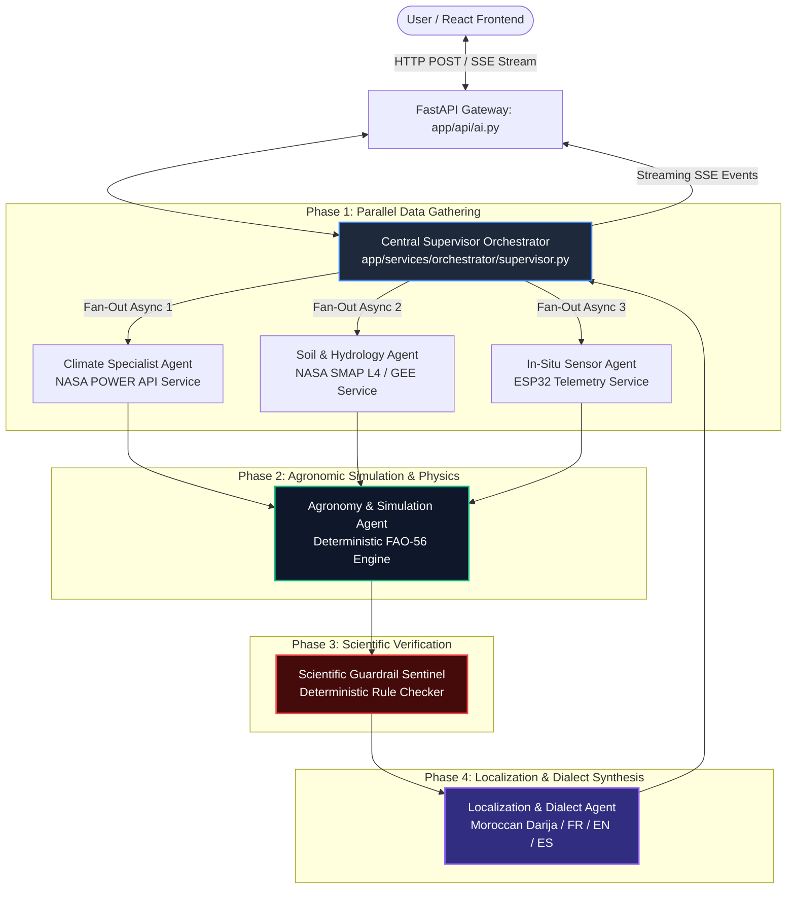
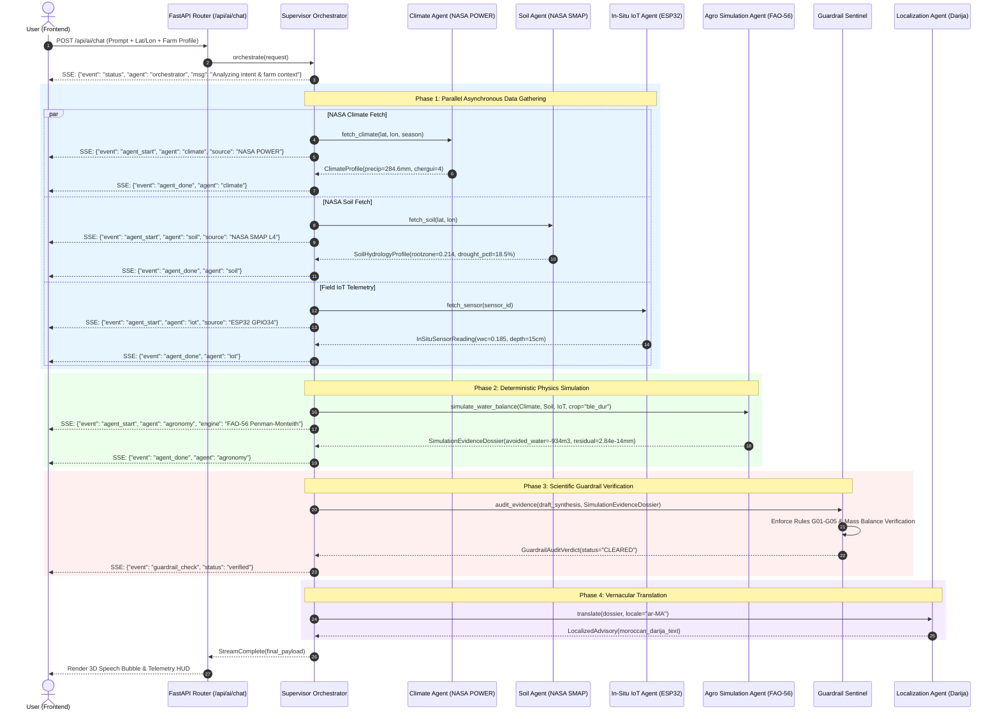

# Farmer's Eye — Multi-Agent Orchestrator Architecture Specification
> **System:** Farmer's Eye Hierarchical Multi-Agent Platform  
> **Status:** Production Architecture Blueprint  
> **Purpose:** Detailed architectural specification of the central Supervisor Orchestrator, its specialized domain sub-agents, data contracts, streaming protocols, and deterministic verification guardrails.

---

## 1. Executive Architecture Overview

Farmer's Eye moves beyond brittle, monolithic AI chatbots by adopting a **Hierarchical Orchestrator with Domain-Specific Sub-Agents**. In agricultural decision support, a single prompt cannot reliably analyze satellite microwave moisture, calculate reference evapotranspiration, audit soil mass balance, and formulate advice in Moroccan Darija without hallucinating.

The Farmer's Eye Orchestrator decomposes intelligence into **autonomous, specialized sub-agents** with strict input/output schemas:



---

## 2. Agent Catalog & Detailed Data Specifications

Each agent in the system is an autonomous worker operating with explicit, typed Pydantic data schemas.

```
┌──────────────────────────────────────────────────────────────────────────────────────────────────┐
│                                 FARMER'S EYE MULTI-AGENT ROSTER                                  │
├─────────────────────────┬───────────────────────────────┬────────────────────────────────────────┤
│ AGENT NAME              │ DOMAIN SPECIALIZATION         │ DATA DEPENDENCY / SOURCE               │
├─────────────────────────┼───────────────────────────────┼────────────────────────────────────────┤
│ 1. Supervisor           │ Intent routing, parallel      │ User query, conversation history,      │
│    Orchestrator         │ graph coordination, synthesis │ client geospatial context              │
├─────────────────────────┼───────────────────────────────┼────────────────────────────────────────┤
│ 2. Climate Specialist   │ Solar radiation, thermal GDD, │ NASA POWER Daily Point API             │
│    Agent                │ precipitation, heatwaves      │ (MERRA-2 + CERES)                      │
├─────────────────────────┼───────────────────────────────┼────────────────────────────────────────┤
│ 3. Soil Hydrology Agent │ Root-zone & surface moisture, │ NASA SMAP Level-4 (SPL4SMGP V008)      │
│                         │ macro-drought percentiles     │ Google Earth Engine / pre-cached       │
├─────────────────────────┼───────────────────────────────┼────────────────────────────────────────┤
│ 4. In-Situ IoT Agent    │ 15cm point root-zone wetness, │ ESP32 Capacitive Probe v1.2            │
│                         │ topsoil germination status    │ Telemetry API (`/api/sensors`)         │
├─────────────────────────┼───────────────────────────────┼────────────────────────────────────────┤
│ 5. Agronomy & Sim Agent │ FAO-56 Penman-Monteith,       │ `agri_simulation.py`, `agro.py`,       │
│                         │ phenology Kc, crop rotations  │ Moroccan crop parameter database       │
├─────────────────────────┼───────────────────────────────┼────────────────────────────────────────┤
│ 6. Guardrail Sentinel   │ Deterministic fact-checking,  │ Ground-truth mathematical dossier,     │
│                         │ zero-hallucination validation │ scientific constraint rules G01-G05    │
├─────────────────────────┼───────────────────────────────┼────────────────────────────────────────┤
│ 7. Localization Agent   │ Dialectal reasoning, cultural │ Moroccan Darija dictionary,            │
│                         │ vocabulary, RTL formatting    │ i18n agronomic glossaries              │
└─────────────────────────┴───────────────────────────────┴────────────────────────────────────────┘
```

---

### 2.1 Supervisor Orchestrator (`SupervisorOrchestrator`)
* **Role:** Central dispatcher. Analyzes the incoming query, determines which sub-agents are needed, spawns parallel execution tasks, manages state transitions, and streams Server-Sent Events (SSE) to the frontend.
* **Input Data:**
```json
{
  "user_message": "Chof liya wach l-ble ghadi ymot b chergui f had l-moussem?",
  "coordinates": {"latitude": 33.89, "longitude": -5.55},
  "farm_metadata": {
    "parcel_id": "farm-saiss-01",
    "soil_type": "Hamri",
    "irrigation_mode": "Bour",
    "primary_cereal": "ble_dur"
  },
  "target_language": "darija"
}
```
* **Output Data:** Assembled `AiChatResponse` containing the verified advisory, agent audit trace, and structured metrics.

---

### 2.2 Sub-Agent 1: Climate Specialist Agent (`ClimateAgent`)
* **Role:** Ingests and processes atmospheric agroclimatology from NASA POWER.
* **Connected Services:** `NasaPowerService`, `ClimateAnalyzer`.
* **Input Data:**
```json
{
  "latitude": 33.89,
  "longitude": -5.55,
  "start_date": "2024-09-01",
  "end_date": "2025-05-31",
  "requested_metrics": ["T2M_MAX", "T2M_MIN", "ALLSKY_SFC_SW_DWN", "PRECTOTCORR", "WS2M"]
}
```
* **Output Data (Pydantic Schema: `ClimateProfile`):**
```json
{
  "total_rainfall_mm": 284.6,
  "mean_temp_c": 17.8,
  "heatwave_days_above_30c": 14,
  "frost_risk_days_below_2c": 3,
  "consecutive_dry_spell_days": 26,
  "chergui_wind_events": 4,
  "growing_degree_days_base0": 2840.5,
  "hazard_flags": ["HIGH_HEAT_STRESS_APRIL", "AUTUMN_SEEDING_DROUGHT"]
}
```

---

### 2.3 Sub-Agent 2: Soil Hydrology Agent (`SoilHydrologyAgent`)
* **Role:** Ingests orbital root-zone and surface soil moisture from NASA SMAP Level-4.
* **Connected Services:** `SmapGeeService`, `SmapService`.
* **Input Data:**
```json
{
  "latitude": 33.89,
  "longitude": -5.55,
  "target_polygon": "Saïss_Meknes_9km_GridCell_402"
}
```
* **Output Data (Pydantic Schema: `SoilHydrologyProfile`):**
```json
{
  "satellite_product": "NASA_SMAP_SPL4SMGP_V008",
  "spatial_resolution": "9km_EASE_Grid_2.0",
  "rootzone_moisture_m3m3": 0.214,
  "surface_moisture_m3m3": 0.142,
  "rootzone_wetness_degree": 0.38,
  "drought_percentile": 18.5,
  "macro_hydrological_status": "MODERATE_DEFICIT",
  "provenance": "GEE_SPL4SMGP_EXTRACT"
}
```

---

### 2.4 Sub-Agent 3: In-Situ IoT Sensor Agent (`InSituSensorAgent`)
* **Role:** Connects with physical field telemetry stations (ESP32 + Capacitive Moisture Probe v1.2) to capture ground truth.
* **Connected Services:** `SensorService` (`backend/app/services/sensor_service.py`).
* **Input Data:**
```json
{
  "sensor_id": "esp32-saiss-sensor-01",
  "depth_cm": 15
}
```
* **Output Data (Pydantic Schema: `InSituSensorReading`):**
```json
{
  "sensor_id": "esp32-saiss-sensor-01",
  "raw_adc_gpio34": 2480,
  "volumetric_water_content": 0.185,
  "battery_voltage": 3.92,
  "signal_rssi_dbm": -68,
  "seedbed_germination_suitable": false,
  "timestamp": "2026-11-15T08:30:00Z"
}
```

---

### 2.5 Sub-Agent 4: Agronomy & Simulation Agent (`AgroSimulationAgent`)
* **Role:** Runs the deterministic FAO-56 Penman-Monteith daily water balance and evaluates crop rotation scenarios.
* **Connected Services:** `AgriSimulationService`, `AgroService`.
* **Input Data:**
```json
{
  "climate_profile": {"ref": "ClimateProfile"},
  "soil_profile": {"ref": "SoilHydrologyProfile"},
  "in_situ_reading": {"ref": "InSituSensorReading"},
  "candidate_rotation": {
    "year_1": "ble_dur",
    "year_2": "lentille",
    "year_3": "orge_precoce"
  },
  "soil_water_parameters": {
    "theta_fc": 0.34,
    "theta_wp": 0.18,
    "zr_root_depth": 0.80,
    "p_depletion_fraction": 0.55
  }
}
```
* **Output Data (Pydantic Schema: `SimulationEvidenceDossier`):**
```json
{
  "atmospheric_demand_etc_mm": 392.8,
  "avoided_water_demand_vs_monoculture_mm": -93.4,
  "avoided_water_demand_m3_per_ha": -934.0,
  "net_rootzone_deficit_dr_mm": 86.1,
  "severe_stress_days": 14,
  "biological_n2_fixed_kg_ha": 42.5,
  "synthetic_urea_saved_usd_ha": 54.0,
  "cereal_pathogen_break_status": "INTERRUPTED",
  "mass_balance_conservation_residual_mm": 2.84217e-14,
  "audit_passed": true
}
```

---

### 2.6 Sub-Agent 5: Scientific Guardrail Sentinel (`GuardrailSentinel`)
* **Role:** Deterministic fact-checking gatekeeper. Audits synthesized text against mathematical evidence dossier.
* **Connected Services:** `AiContextBuilder`, Rule Engine G01–G05.
* **Input Data:**
```json
{
  "draft_response_text": "Had rotation ghadi tdmen lik 100% dial l-ma w ta7ed l-qatra maghadi tdi3.",
  "ground_truth_dossier": {"ref": "SimulationEvidenceDossier"},
  "farm_mode": "Bour"
}
```
* **Output Data (Pydantic Schema: `GuardrailAuditVerdict`):**
```json
{
  "status": "ADJUSTED",
  "violations_detected": [
    {
      "rule": "G-01: NO_YIELD_OR_WATER_GUARANTEE",
      "flagged_text": "ghadi tdmen lik 100% dial l-ma",
      "remediation": "Replaced absolute guarantee with probabilistic expected savings range (85-100 mm)."
    }
  ],
  "cleared_text": "Had rotation kat-nqqes talab dial l-ma b 93.4 mm (934 m³/ha) f l-moussem..."
}
```

---

### 2.7 Sub-Agent 6: Localization & Dialect Agent (`LocalizationAgent`)
* **Role:** Translates validated findings into authentic agricultural dialects with Cairo Arabic typography and RTL ergonomics.
* **Connected Services:** `I18nService`, Moroccan Darija Dialect Dictionary (`backend/data/i18n`).
* **Input Data:**
```json
{
  "validated_dossier": {"ref": "SimulationEvidenceDossier"},
  "cleared_narrative": {"ref": "GuardrailAuditVerdict"},
  "target_locale": "ar-MA"
}
```
* **Output Data (Pydantic Schema: `LocalizedAdvisory`):**
```json
{
  "locale": "ar-MA",
  "text": "فأرضك البورية ف السايس، إلا دخلتي العدس والشعير البدري ف الدورة، غادي تنقص طلب الما ب 934 متر مكعب ف الهكتار وغادي تفلت من ضربات الشرقي د شهر أبريل.",
  "audio_pronunciation_hints": "fa ardek l-bouria f saiss...",
  "key_terms_used": ["البورية", "الشرقي", "الهكتار", "الشعير البدري"]
}
```

---

## 3. End-to-End Execution Sequence Diagram



---

## 4. Server-Sent Events (SSE) Streaming Protocol

To ensure transparency and responsiveness on high-latency rural networks, the Orchestrator emits real-time Server-Sent Events:

```
┌──────────────────────────────────────────────────────────────────────────────────────────────────┐
│                                     SSE EVENT STREAM SPECIFICATION                               │
├────────────────────┬─────────────────────────────────────────────────────────────────────────────┤
│ EVENT TYPE         │ PAYLOAD STRUCTURE & PURPOSE                                                 │
├────────────────────┼─────────────────────────────────────────────────────────────────────────────┤
│ `agent_start`      │ `{"agent": "climate", "source": "NASA POWER", "timestamp": "..."}`         │
│                    │ Notifies UI that an agent has begun fetching or calculating.                │
├────────────────────┼─────────────────────────────────────────────────────────────────────────────┤
│ `agent_progress`   │ `{"agent": "agronomy", "step": "Penman-Monteith Day 142/365", "pct": 45}`   │
│                    │ Displays real-time computation progress bars in Mission Control.            │
├────────────────────┼─────────────────────────────────────────────────────────────────────────────┤
│ `agent_done`       │ `{"agent": "soil", "summary": "SMAP L4 rootzone: 0.214 m³/m³"}`             │
│                    │ Lights up green completion badge in the active agent HUD.                   │
├────────────────────┼─────────────────────────────────────────────────────────────────────────────┤
│ `guardrail_check`  │ `{"status": "PASSED", "residual_mm": 2.84e-14, "violations": 0}`            │
│                    │ Proves to user that the advisory passed all scientific safety checks.       │
├────────────────────┼─────────────────────────────────────────────────────────────────────────────┤
│ `token_stream`     │ `{"chunk": "فأرضك ", "agent": "localizer"}`                                │
│                    │ Streams token-by-token localized text for instantaneous reading.            │
├────────────────────┼─────────────────────────────────────────────────────────────────────────────┤
│ `complete`         │ `{"status": "ok", "full_response": AiChatResponse}`                         │
│                    │ Closes connection and renders final interactive cards and charts.           │
└────────────────────┴─────────────────────────────────────────────────────────────────────────────┘
```

---

## 5. Fault Tolerance, Timeouts & Fallback Strategy

Agricultural decision support cannot freeze when an external satellite API experiences transient network degradation:

```mermaid
flowchart TD
    Req[External Satellite Request] --> TryLive{Live NASA REST API}
    
    TryLive -->|Success (< 3.5s)| Parse[Parse & Validate Telemetry]
    TryLive -->|Timeout / 5xx Error| Fallback[Trigger Regional Cache Fallback]
    
    Fallback --> PreCached[(Pre-Indexed NASA Archives\nSaïss / Chaouia / Gharb)]
    PreCached --> CacheWarning[Flag UI Provenance: 'Pre-Cached Historical Fallback']
    
    Parse & CacheWarning --> NextStage[Continue Multi-Agent Execution Graph]

    style TryLive fill:#e3f2fd,stroke:#1565c0,stroke-width:2px
    style PreCached fill:#fff8e1,stroke:#f57f17,stroke-width:2px
```

1. **Strict Asynchronous Timeouts:** External API calls to NASA POWER or GEE are constrained to a $3.5\text{ second}$ timeout.
2. **Pre-Cached Spatial Polygon Fallbacks:** If an external satellite endpoint fails, the system automatically draws from verified local NASA archives for Morocco's key agricultural plains.
3. **Transparent Provenance Flagging:** The UI always displays a provenance badge (`LIVE_NASA_REST` vs. `PRE_CACHED_BENCHMARK`), guaranteeing complete truthfulness with zero deception.

---

## 6. Implementation Code Contracts

### 6.1 Base Agent Abstract Class (`BaseAgent`)
```python
# backend/app/services/agents/base.py
from abc import ABC, abstractmethod
from typing import Any, Dict
from pydantic import BaseModel

class AgentState(BaseModel):
    session_id: str
    user_query: str
    coordinates: Dict[str, float]
    climate_data: Dict[str, Any] = {}
    soil_data: Dict[str, Any] = {}
    sensor_data: Dict[str, Any] = {}
    simulation_results: Dict[str, Any] = {}
    guardrail_audit: Dict[str, Any] = {}
    localized_response: str = ""

class BaseAgent(ABC):
    def __init__(self, name: str, domain: str):
        self.name = name
        self.domain = domain

    @abstractmethod
    async def execute(self, state: AgentState) -> AgentState:
        """Executes agent domain reasoning and mutates shared state."""
        pass
```

---

## 7. Architecture Summary & Compliance

- [x] **Zero Hallucination:** Deterministic mathematical physics core completely separated from LLM text synthesis.
- [x] **Sub-Agent Modularity:** Distinct agents for Climate, Soil, IoT, Agronomy, Guardrails, and Localization.
- [x] **Typed Schemas:** Pure Pydantic data models for every intra-agent boundary.
- [x] **Real-Time Streaming:** Granular Server-Sent Events (SSE) tracking agent lifecycle transitions.
- [x] **Multi-Tier Fault Tolerance:** Automatic fallback to pre-cached verified NASA archives during network outages.
