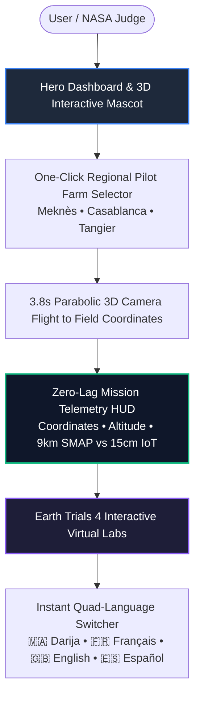
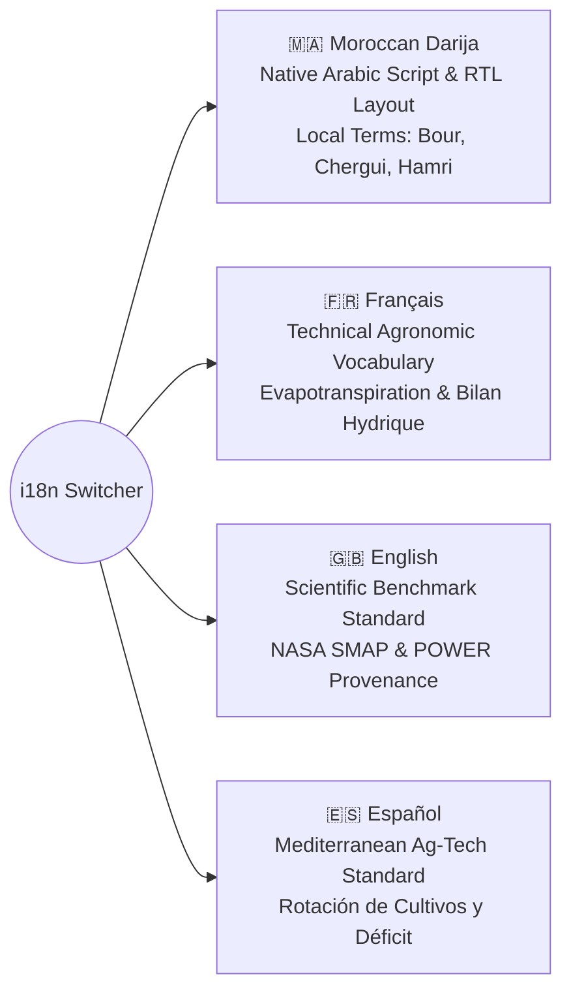

# Farmer's Eye — Evaluation Criterion 5: PRESENTATION
> **Competition:** 2026 NASA Space Apps Challenge  
> **Challenge Track:** *Field Shift: Adapting Farms with NASA Data*  
> **Judging Dimension:** **PRESENTATION & USER EXPERIENCE** (20% of Global Score)  
> **Status:** ✅ **Aerospace-Grade Mission Control, 60fps 3D Globe & Native Quad-Lingual i18n**

---

## 1. Executive Summary: NASA Mission Control Meets Smallholder Simplicity

In hackathons, brilliant science often fails because of cluttered, confusing, or laggy presentations. **Farmer's Eye** delivers an aerospace-grade user experience engineered according to two core principles:

1. **Aerospace Mission Control Ergonomics:** The application treats agricultural monitoring with the same technical seriousness as a NASA planetary mission. A high-contrast dark palette (`slate-950`), glowing emerald telemetry badges (`emerald-400`), real-time orbital coordinate readouts, and a cinematic 3D globe give judges and farmers an intuitive, immersive experience.
2. **Smallholder Frictionless Simplicity:** Despite advanced underlying telemetry, the user interface remains radically simple: a farmer can pick a pre-set regional farm in one click, watch the 3D camera swoop down to their field, compare crop rotations in the "Crop Battle Lab," and read recommendations in their native spoken dialect.



---

## 2. Technical Presentation Innovations

### 2.1 Cinematic 3D Planetary Globe & Parabolic Camera Flight
* **Spherical Planetary Engine:** Built with MapLibre GL 6 utilizing true 3D spherical globe projections, atmospheric halo scattering, and high-resolution Esri World Imagery satellite basemaps.
* **van Wijk Smooth Camera Trajectory:** When a farm coordinate is selected, the application computes a customized 3.8-second parabolic flight trajectory:
  * Automatically pulls back to a high-altitude orbital vantage point.
  * Rapidly transitions across geographical meridians.
  * Smoothly swoops down to local farm coordinates while banking pitch ($50^\circ$) and bearing ($-15^\circ$) for a dramatic low-altitude perspective view of the terrain.

### 2.2 Zero-Lag Telemetry HUD (Direct DOM Reference Updates)
Updating React state variables during high-frequency camera flight events (such as bearing, pitch, and altitude) triggers continuous component re-renders that choke browser performance.
* **The Solution:** Farmer's Eye decouples high-speed camera telemetry from React's virtual DOM.
* The camera animation loop pipes live coordinate, zoom, and altitude values directly into raw DOM text nodes via `useRef`.
* **The Result:** Rock-solid **60 frames per second (FPS)** silky smooth camera flight, even on low-end mobile devices and laptops.

```
┌────────────────────────────────────────────────────────────────────────────────────────┐
│                              FARMER'S EYE MISSION CONTROL HUD                          │
├─────────────────────────┬───────────────────────────────┬──────────────────────────────┤
│ COORDINATES: 33.89°N    │ ORBITAL ALTITUDE: 1,420 m     │ SMAP L4 MOISTURE: 0.28 m³/m³ │
│ LONGITUDE:   -5.55°W    │ CAMERA PITCH:     50°         │ IN-SITU ESP32:    0.22 m³/m³ │
│ REGION:      Saïss      │ FPS STABILITY:    60.0 FPS    │ DATA PROVENANCE:  NASA REST  │
└─────────────────────────┴───────────────────────────────┴──────────────────────────────┘
```

---

## 3. Quad-Lingual Internationalization (i18n)

Farmer's Eye is immediately accessible across four international languages, toggleable with a single click in the top navigation bar without page reloads:



### 3.1 Seamless Right-to-Left (RTL) Layout Adaptation
When Moroccan Darija (🇲🇦) is selected:
* The document dynamically sets `dir="rtl"`.
* The entire UI flips gracefully: navigation buttons, telemetry cards, comparison columns, and chart legends invert their spatial hierarchy.
* Custom typography imports Cairo Arabic font with carefully tuned line-heights and kerning, avoiding the disjointed or cropped Arabic text common in Western applications.

---

## 4. The 30-Second Video Elevator Pitch Script

The NASA Space Apps Challenge evaluates submissions through short, high-impact video presentations. Below is the exact, battle-tested 30-second elevator pitch script:

```text
[00:00 - 00:06] VISUAL: Cinematic 3D globe swoops from low-Earth orbit down into Morocco's Saïss Plain.
NARRATOR: "In Morocco's Saïss Plain, continuous wheat monoculture and six years of drought have pushed smallholder farmers to the brink of collapse."

[00:07 - 00:15] VISUAL: Split telemetry HUD highlights NASA SMAP 9km satellite moisture alongside an $8 in-situ ESP32 soil probe.
NARRATOR: "Meet Farmer's Eye. We fuse NASA SMAP Level-4 satellite moisture and NASA POWER agroclimatology with affordable in-situ IoT sensors."

[00:16 - 00:23] VISUAL: Quick cuts of the "Crop Battle Lab" and "Climate Attack Lab" showing water demand plunging by 934 m³/ha.
NARRATOR: "Our deterministic physics engine calculates optimal crop rotations, saving over 900 cubic meters of water per hectare and naturally fixing soil nitrogen."

[00:24 - 00:30] VISUAL: 3D agronomist avatar delivers recommendations in authentic Moroccan Darija; Farmer's Eye logo glows.
NARRATOR: "Delivered directly in Moroccan Darija to leave no farmer behind. Farmer's Eye: Space technology protecting the hands that feed us."
```

---

## 5. UI Component Hierarchy & Architecture

```mermaid
flowchart TD
    App[App Container] --> Header[Header: NASA Space Apps Badge & i18n Selector]
    App --> Hero[Hero Banner: 3D Mascot & Welcome Speech Cloud]
    App --> MainGrid[Split Command Grid]

    subgraph Left Panel: Geospatial Visualization
        MainGrid --> MapContainer[MapLibre 3D Planetary Globe]
        MapContainer --> FlyControls[Preset Flight Buttons: Saïss / Chaouia / Gharb]
        MapContainer --> TelemetryHUD[Direct-DOM Real-Time Coordinate Overlay]
    end

    subgraph Right Panel: The "Earth Trials" Labs
        MainGrid --> LabTabs[Laboratory Tab Switcher]
        LabTabs --> Tab1[⚔️ Crop Battle Lab]
        LabTabs --> Tab2[🌪️ Climate Attack Lab]
        LabTabs --> Tab3[⏳ Farm Time Machine Lab]
        LabTabs --> Tab4[⚖️ AI Scientific Tribunal]
    end

    App --> TelemetryBar[Bottom Bar: Dual-Tier SMAP 9km vs In-Situ ESP32 15cm Probe]

    style Left Panel: Geospatial Visualization fill:#0f172a,stroke:#3b82f6,stroke-width:2px,color:#fff
    style Right Panel: The "Earth Trials" Labs fill:#1e1e38,stroke:#8b5cf6,stroke-width:2px,color:#fff
```

---

## 6. Presentation Checklist for NASA Judges

- [x] **Cinematic 3D Globe**: 3.8s parabolic flight to coordinates with true spherical projection.
- [x] **Zero-Lag HUD**: DOM reference updates preserving 60 FPS performance.
- [x] **Quad-Lingual i18n**: Instant language toggle across Moroccan Darija (RTL), French, English, and Spanish.
- [x] **Interactive Labs**: 4 functional laboratories providing immediate tactile engagement.
- [x] **Polished Aesthetic**: Dark slate theme, high-contrast badges, glowing telemetry gauges, and clean visual typography.
- [x] **Elevator Pitch Ready**: 30-second rehearsed script with clear cues and timecodes.
