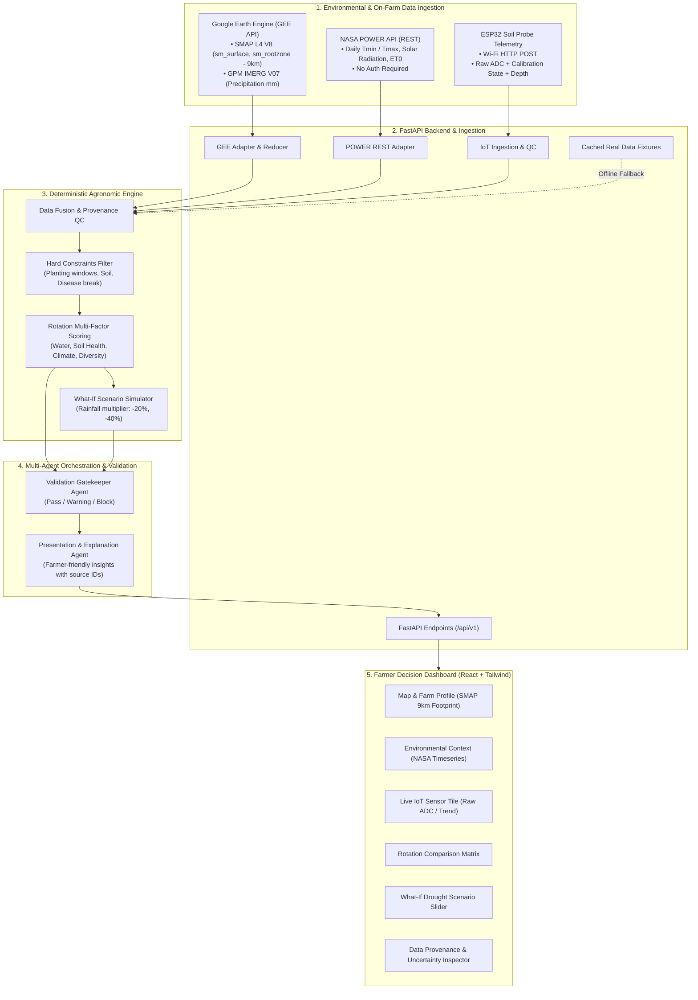

# Farmer's Eye — Master Project & Implementation Plan

> **Competition:** NASA Space Apps Challenge 2026 — *Field Shift: Adapting Farms with NASA Data*  
> **Product Name:** Farmer's Eye  
> **Tagline:** Adaptive Crop Rotation with NASA Earth Observations + Local IoT  
> **Document Version:** 1.0.0 (Updated with Google Earth Engine architecture)  
> **Date:** November 14, 2026  

---

## 1. Executive Summary & Strategic Positioning

### 1.1 The Challenge
Farmers worldwide face unprecedented climate volatility: shifting rainy seasons, chronic groundwater depletion, extreme heat waves, and soil degradation. Most farmers rely on historical habits (e.g., continuous mono-cropping of cereals), which amplifies vulnerability to drought and depletes soil nutrients.

### 1.2 Our Solution
**Farmer's Eye** is an explainable, scientifically defensible crop-rotation decision-support platform. It bridges the gap between **coarse regional satellite observations** and **local on-farm realities**:
1. **Regional Environmental Context:** Google Earth Engine (SMAP 9 km soil moisture & GPM IMERG precipitation) + NASA POWER (daily agrometeorology & temperature).
2. **Local Farm Ground Truth:** ESP32 soil moisture sensor telemetry with explicit calibration and depth tracking.
3. **Deterministic Agronomic Engine:** Hard crop constraints, seasonal water balances, crop-family succession rules, and multi-factor scoring (no hallucinated LLM numbers).
4. **Scientific Validation Gate:** Multi-agent pipeline where the validation agent can block unsupported claims and flag missing farm inputs.
5. **Interactive "What-If" Drought Simulator:** Allows farmers and agronomists to test rotation resilience against -20% to -50% rainfall deficits before planting.

### 1.3 Key Differentiators (Why This Wins)
* **No "Black Box" LLM Math:** All calculations (water demand, feasibility checks, rotation scores) run in deterministic, fully tested Python functions. AI models strictly orchestrate, validate, and explain.
* **Scientific Honesty on Spatial Resolution:** We never claim that an ESP32 sensor or interpolation "downscales" a 9 km SMAP pixel to a micro-farm. Regional estimates and point measurements are displayed as complementary, distinct layers with clear provenance.
* **Offline Resilience for Hackathon Judging:** Live adapters query Google Earth Engine and NASA POWER; if external networks or credentials fail during a pitch, the system gracefully falls back to cached real satellite data fixtures without breaking.

---

## 2. Pilot Farm & Crop Scenario Definition

To ensure scientific credibility, the project is configured around a real, drought-vulnerable agricultural pilot:

### 2.1 Pilot Location
* **Region:** Saïss Plain / Fès-Meknès Region, Morocco
* **Coordinates:** `34.0300° N, -4.9800° W`
* **Climate:** Semi-arid Mediterranean; hot dry summers, variable winter precipitation (350–500 mm annually).
* **Soil Type:** Clay-loam, alkaline (pH ~7.8–8.2), prone to compaction and surface crusting.

### 2.2 Crop Catalog (Pilot Set)
| Crop | Botanical Family | Water Demand ($ET_c$) | Drought Tolerance | Agronomic Function |
|---|---|---|---|---|
| **Durum Wheat** (*Triticum durum*) | *Poaceae* (Cereal) | Medium-High (450–550 mm) | Moderate | Regional staple, cash crop; high disease risk if continuously grown. |
| **Barley** (*Hordeum vulgare*) | *Poaceae* (Cereal) | Low-Medium (350–450 mm) | Very High | Excellent drought and salinity tolerance; fodder/grain. |
| **Chickpea** (*Cicer arietinum*) | *Fabaceae* (Legume) | Low (250–350 mm) | High (deep taproot) | Atmospheric $N_2$ fixation; breaks cereal root-rot (*Fusarium*) cycles. |
| **Fava Bean** (*Vicia faba*) | *Fabaceae* (Legume) | Medium (350–450 mm) | Moderate | High biomass and nitrogen contribution; improves soil organic matter. |

### 2.3 Rotation Scenarios Compared in MVP
1. **Baseline (Current Farmer Habit):**  
   `Durum Wheat` ➔ `Durum Wheat` ➔ `Barley`  
   *Assessment:* Depletes soil nitrogen, increases root pathogen accumulation, highly vulnerable to consecutive dry years.
2. **Alternative A (Water-Conserving Strategy):**  
   `Barley` ➔ `Chickpea` ➔ `Barley`  
   *Assessment:* Minimizes total seasonal irrigation need; legume break fixes ~40–60 kg N/ha; high drought survival index.
3. **Alternative B (Balanced Soil Recovery & Yield):**  
   `Durum Wheat` ➔ `Chickpea` ➔ `Durum Wheat`  
   *Assessment:* Preserves staple wheat production while interrupting pest cycles and reducing synthetic fertilizer dependency.

---

## 3. End-to-End System Architecture



---

## 4. Detailed Component Specifications

### 4.1 Data Ingestion & Google Earth Engine Integration
* **SMAP L4 Geophysical Data V8 (`NASA_SMAP_SPL4SMGP_008`):**
  * Target bands: `sm_surface` (0–5 cm, $\text{m}^3/\text{m}^3$) and `sm_rootzone` (0–100 cm, $\text{m}^3/\text{m}^3$).
  * Temporal step: 3-hourly assimilation.
  * Spatial support: 9 km EASE-Grid 2.0.
  * GEE Extraction: `reduceRegion` with `ee.Reducer.mean()` at the farm coordinates over the selected seasonal date range.
* **GPM IMERG V07 Precipitation (`NASA/GPM_L3/IMERG_V07`):**
  * Target band: `precipitationCal` (calibrated rainfall accumulation).
  * Temporal step: Daily / Monthly aggregation.
* **NASA POWER API (`/api/temporal/daily/point`):**
  * Open, no-credential REST API.
  * Variables: `T2M` (Mean Temp), `T2M_MAX`, `T2M_MIN`, `PRECTOTCORR` (Precipitation correction), `ALLSKY_SFC_SW_DWN` (Solar radiation).
  * Used for calculating cumulative Growing Degree Days (GDD) and climate extremes.
* **Offline Fixtures:**
  * Clean JSON files in `data/demo_fixtures/` containing actual extracted GEE and POWER data for the pilot farm, ensuring zero-downtime presentations.

### 4.2 Local IoT Sensor Pipeline (ESP32)
* **Telemetry Payload Contract (`POST /api/v1/sensors/readings`):**
  ```json
  {
    "device_id": "esp32-saiss-01",
    "farm_id": "farm-saiss-pilot",
    "timestamp_utc": "2026-11-14T10:00:00Z",
    "sensor_model": "Capacitive_v1.2",
    "depth_cm": 15,
    "raw_adc": 2180,
    "calibration_status": "uncalibrated",
    "soil_moisture_vwc_m3_m3": null,
    "battery_voltage": 3.28
  }
  ```
* **Firmware:** Compact C++ Arduino sketch for ESP32 with Wi-Fi reconnection, moving-average ADC filter, and token authentication.
* **Hardware Simulator:** Python script (`scripts/simulate_esp32.py`) to stream realistic mock sensor readings when testing without physical hardware.

### 4.3 Deterministic Agronomic Decision Logic
The decision core operates strictly in Python (no LLM in the numerical loop):
1. **Feasibility Gate (Hard Constraints):**
   * *Planting Window Check:* Compares historical soil moisture/temperature trigger dates against crop requirements.
   * *Crop Family Succession Rule:* Forbids monoculture cereals (`Poaceae` ➔ `Poaceae` ➔ `Poaceae`) without a disease break interval; mandates legume inclusion for soil recovery.
   * *Extreme Drought Feasibility:* If seasonal available water (rain + irrigation) $< 250\text{ mm}$, high-demand crops (`Durum Wheat`) are marked `infeasible_under_current_water`.
2. **Transparent Multi-Factor Scoring Formula:**
   $$\text{Score}(R) = w_{\text{water}} \cdot S_{\text{water}} + w_{\text{soil}} \cdot S_{\text{soil}} + w_{\text{climate}} \cdot S_{\text{climate}} + w_{\text{div}} \cdot S_{\text{diversity}} - \text{RiskPenalty}$$
   * Default weights: $w_{\text{water}} = 0.35$, $w_{\text{soil}} = 0.25$, $w_{\text{climate}} = 0.20$, $w_{\text{div}} = 0.20$.
   * Weights are user-configurable in the UI to match individual farmer priorities.
3. **What-If Scenario Simulation Engine:**
   * Farmers adjust rainfall assumptions (e.g., $100\%$, $80\%$, $60\%$) or irrigation constraints.
   * The engine re-executes the scoring pipeline deterministically and updates rankings in real-time.

### 4.4 Multi-Agent Validation System
* **Data Retrieval Agent:** Normalizes satellite time series and local sensor data; flags low-quality or missing flags.
* **Agronomic Analysis Agent:** Runs crop database matching, generates rotation permutations, and computes water deficits.
* **Scientific Validation Agent (The Gatekeeper):**
  * Verifies that all units are valid ($\text{m}^3/\text{m}^3$, $\text{mm}$, $^\circ\text{C}$).
  * Verifies sensor calibration status (blocks misleading "% moisture" labels for uncalibrated ADC readings).
  * Rejects candidate rotations that violate biological disease break periods.
* **Presentation Agent:**
  * Synthesizes mathematical scores into clear agronomic narratives.
  * Cites exact source IDs (e.g., `[NASA_SMAP_L4_V8]`, `[ESP32_RAW_ADC]`).

### 4.5 Farmer Decision Dashboard (Frontend)
Built with **React 19 + Tailwind CSS + MapLibre / Lucide icons**:
* **Farm Profile & Interactive Map:** Displays farm boundary and overlay of the 9 km SMAP grid cell.
* **Environmental Context Section:** NASA POWER temperature trends, GPM rainfall history, and SMAP surface/root-zone moisture.
* **IoT Sensor Card:** Displays connection status, probe depth (e.g., 15 cm), raw ADC reading, and historical wetness trend.
* **Rotation Comparison Matrix:** Side-by-side comparative cards (Baseline vs Alternative A vs Alternative B) with score breakdowns, water footprints, and nitrogen balance indicators.
* **What-If Drought Simulator Bar:** Interactive slider dynamically re-scoring rotations under drought conditions.
* **Data Provenance Drawer:** Complete transparency showing satellite collection IDs, acquisition timestamps, and uncertainty caveats.

---

## 5. Phased Implementation Roadmap

```
Phase 0: Setup & Specs ──► Phase 1: Data Adapters ──► Phase 2: IoT Pipeline ──► Phase 3: Science Engine ──► Phase 4: Agents & UI ──► Phase 5: Pitch
```

### Phase 0: Project Foundation & Tracking (Immediate)
- [x] Master Context defined (`docs/FARMER_EYE_MASTER_CONTEXT.md`).
- [x] Google Earth Engine architectural transition approved.
- [ ] Create `docs/PROGRESS.md` to track live implementation milestones.
- [ ] Initialize Python backend environment with `pyproject.toml` (FastAPI, Pydantic, httpx, earthengine-api, pytest).

### Phase 1: Environmental Data Adapters (GEE + POWER)
- [ ] Implement `backend/app/adapters/nasa_power.py` (instant REST client for temperature/precipitation).
- [ ] Implement `backend/app/adapters/earth_engine.py` (SMAP L4 `NASA_SMAP_SPL4SMGP_008` & GPM IMERG `NASA/GPM_L3/IMERG_V07`).
- [ ] Create cached JSON data fixtures in `data/demo_fixtures/` for the Saïss pilot farm.
- [ ] Unit tests for data schema validation, unit conversions, and provenance attribution.

### Phase 2: ESP32 IoT Telemetry Pipeline
- [ ] Implement `POST /api/v1/sensors/readings` endpoint with Pydantic validation.
- [ ] Create ESP32 Arduino/C++ firmware in `firmware/esp32_soil_sensor/`.
- [ ] Create Python test streamer `scripts/simulate_esp32.py`.
- [ ] Add sensor data persistence (SQLite for MVP) and latest reading retrieval.

### Phase 3: Deterministic Agronomic Core & What-If Engine
- [ ] Build crop catalog in `backend/app/science/crop_catalog.py` (Wheat, Barley, Chickpea, Fava Bean).
- [ ] Implement hard feasibility constraints in `backend/app/science/constraints.py`.
- [ ] Implement multi-season rotation scoring in `backend/app/science/rotation_scoring.py`.
- [ ] Implement what-if drought simulator in `backend/app/science/scenario_engine.py`.
- [ ] Unit tests verifying that drought penalties correctly demote water-intensive monocultures.

### Phase 4: Multi-Agent Validation Gate & API Integration
- [ ] Build agent state graph and tool bindings in `backend/app/agents/`.
- [ ] Implement the Scientific Validation Gate (enforcing data provenance and blocking unverified claims).
- [ ] Wire `/api/v1/farms/{farm_id}/rotations/evaluate` and `/api/v1/farms/{farm_id}/scenarios`.
- [ ] Verify that missing data produces explicit warnings instead of hallucinations.

### Phase 5: Frontend Dashboard & Live Demo Polish
- [ ] Build React 19 dashboard components in `frontend/src/`:
  - `MapCard.jsx`: Farm location & 9 km satellite footprint.
  - `ObservationCharts.jsx`: SMAP root-zone moisture & GPM rainfall.
  - `SensorCard.jsx`: Live ESP32 probe reading and calibration badge.
  - `RotationComparison.jsx`: Side-by-side rotation matrix.
  - `WhatIfSlider.jsx`: Interactive rainfall reduction control.
  - `ProvenanceDrawer.jsx`: Satellite metadata and uncertainty logs.
- [ ] Connect React frontend to FastAPI backend.
- [ ] Record offline-safe demonstration walkthrough.
- [ ] Finalize README with quick-start instructions (`./run_demo.sh`).

---

## 6. Live Pitch & Demonstration Script (Judge Walkthrough)

1. **The Hook (0:00 - 0:20):**  
   *"Farmers in drought-prone regions like Morocco are losing crops because traditional crop choices no longer match shifting rainfall patterns. But generic AI chatbots hallucinate agricultural advice, while regional satellites are too coarse for farm-level decisions."*
2. **The Innovation (0:20 - 0:45):**  
   *"Farmer's Eye solves this by fusing Google Earth Engine satellite data (SMAP L4 9km soil moisture + GPM IMERG rain) with real on-farm ESP32 soil probe readings, evaluated through a deterministic, peer-reviewed agronomic engine."*
3. **The Live Demo (0:45 - 1:30):**  
   * **Show Farm Map & Satellite Footprint:** Demonstrating honest 9 km spatial representation.  
   * **Show Live Sensor Tile:** Demonstrating real-time ESP32 telemetry with clear ADC calibration status.  
   * **Compare 3 Rotations:** Baseline (Wheat-Wheat-Barley) vs Alternative A (Barley-Chickpea-Barley) showing how the legume break restores nitrogen and saves water.  
   * **Move What-If Slider to -30% Drought:** Watch the engine dynamically recalculate and prove why the resilient rotation survives while the baseline fails.  
   * **Open Provenance Drawer:** Showing every NASA product ID, collection date, and uncertainty flag.
4. **Conclusion & Impact (1:30 - 2:00):**  
   *"Farmer's Eye delivers transparent, evidence-backed decision support: saving water, rebuilding soil resilience, and empowering farmers with the full power of NASA Earth observations."*

