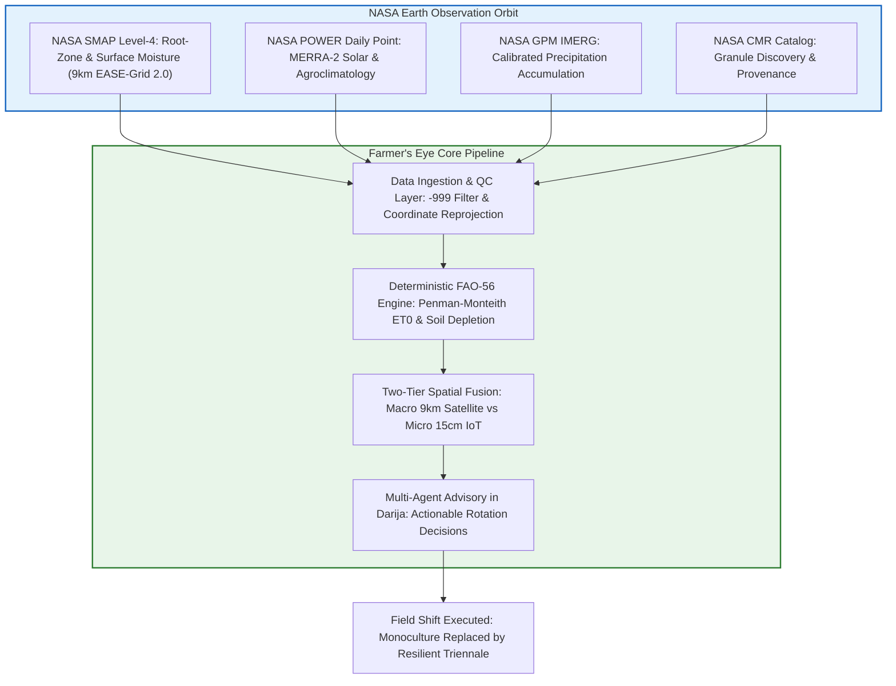
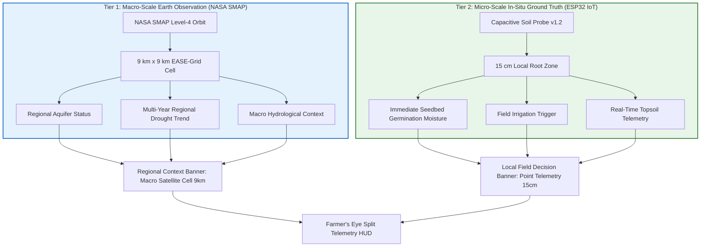

# Farmer's Eye — Evaluation Criterion 4: RELEVANCE
> **Competition:** 2026 NASA Space Apps Challenge  
> **Challenge Track:** *Field Shift: Adapting Farms with NASA Data*  
> **Judging Dimension:** **RELEVANCE & NASA DATA UTILIZATION** (20% of Global Score)  
> **Live Documentation Portal:** [https://nasa-docs.vercel.app/](https://nasa-docs.vercel.app/)  
> **Status:** ✅ **End-to-End Ingestion, Assimilation & Actionable Grounding of NASA Earth Observations**

---

## 1. Challenge Alignment: Direct Answer to "Field Shift"

The 2026 NASA Space Apps Challenge prompt, **"Field Shift: Adapting Farms with NASA Data,"** challenges solvers to:
> *"Develop a tool that uses NASA Earth observation data to help farmers understand how climate shifts impact their land, and empower them to adapt cropping choices, management strategies, and field operations."*

**Farmer's Eye** was conceived and engineered specifically for this mandate. Rather than treating NASA data as a decorative background map or generic dashboard widget, Farmer's Eye feeds raw NASA observations directly into its daily agro-hydrological physics engine to drive decisive cropping shifts:



---

## 2. Comprehensive NASA Earth Science Data Sheet

Farmer's Eye assimilates three primary NASA Earth Science data products, plus NASA's Common Metadata Repository (CMR) for temporal granule verification:

```
┌──────────────────────────────────────────────────────────────────────────────────────────────────┐
│                                 NASA EARTH OBSERVATION DATA ASSETS                               │
├───────────────────┬──────────────────────┬────────────────────────┬──────────────────────────────┤
│ DATASET           │ SATELLITE / MISSION  │ SPATIAL / TEMPORAL RES │ SCIENTIFIC VARIABLES USED    │
├───────────────────┼──────────────────────┼────────────────────────┼──────────────────────────────┤
│ 1. SMAP L4        │ Soil Moisture Active │ 9 km global EASE-Grid  │ • sm_rootzone (0-100 cm)     │
│    (SPL4SMGP V008)│ Passive (SMAP)       │ 3-hourly assimilation  │ • sm_surface (0-5 cm)        │
│                   │                      │                        │ • sm_rootzone_wetness (0-1)  │
│                   │                      │                        │ • Leaf Area Index (LAI)      │
│                   │                      │                        │ • Infiltration flux (kg/m²s) │
├───────────────────┼──────────────────────┼────────────────────────┼──────────────────────────────┤
│ 2. NASA POWER     │ Merged MERRA-2 &     │ 0.5° x 0.625° point    │ • ALLSKY_SFC_SW_DWN (Solar)  │
│    Daily Point    │ CERES Satellite      │ Daily continuous       │ • T2M_MIN, T2M_MAX, T2M_MEAN │
│                   │                      │                        │ • RH2M (Relative Humidity)   │
│                   │                      │                        │ • WS2M (Wind Speed at 2m)    │
│                   │                      │                        │ • PRECTOTCORR (Precipitation)│
├───────────────────┼──────────────────────┼────────────────────────┼──────────────────────────────┤
│ 3. GPM IMERG V07  │ Global Precipitation │ 0.1° x 0.1° (~10 km)   │ • precipitationCal           │
│                   │ Measurement (GPM)    │ Daily / Multi-satellite│ • Regional rainfall truth    │
├───────────────────┼──────────────────────┼────────────────────────┼──────────────────────────────┤
│ 4. NASA CMR       │ EOSDIS Common        │ Global spatio-temporal │ • Granule temporal bounds    │
│    Catalog API    │ Metadata Repository  │ catalog search         │ • Sensor provenance audit    │
└───────────────────┴──────────────────────┴────────────────────────┴──────────────────────────────┘
```

---

### 2.1 NASA SMAP Level-4 (SPL4SMGP V008)
* **What it is:** The SMAP Level-4 Global 3-hourly $9\text{ km}$ EASE-Grid Surface and Root-Zone Soil Moisture Geophysical Data product merges L-band microwave observations with the NASA Catchment land surface model using an Ensemble Kalman Filter (EnKF).
* **Role in Farmer's Eye:** 
  1. Supplies $0\text{--}100\text{ cm}$ root-zone volumetric soil moisture ($\text{m}^3/\text{m}^3$), which governs the initial moisture state ($D_{r,0}$) for all rotation simulations.
  2. Provides root-zone soil wetness degree ($0.0\text{--}1.0$), establishing the regional background drought baseline.
  3. Ingests biosphere variables including vegetation greenness fraction and Leaf Area Index ($LAI$) to validate crop growth progression.

### 2.2 NASA POWER Agroclimatology (Prediction of Worldwide Energy Resources)
* **What it is:** A global synthesis combining NASA MERRA-2 atmospheric reanalysis with CERES satellite solar irradiance observations.
* **Role in Farmer's Eye:**
  1. Supplies the exact daily meteorological inputs required by the FAO-56 Penman-Monteith equation ($T_{\min}, T_{\max}, R_n, RH, u_2$).
  2. Computes Growing Degree Days ($GDD$) with a $0^\circ\text{C}$ base temperature for cereal phenological tracking.
  3. Tracks extreme agro-climatic hazard indicators: heat stress days ($T_{\max} \ge 30^\circ\text{C}$), frost risk nights ($T_{\min} \le 2^\circ\text{C}$), and consecutive dry spells ($P < 1\text{ mm}$).

### 2.3 NASA GPM IMERG V07 (Global Precipitation Measurement)
* **What it is:** Calibrated multi-satellite precipitation estimates from the GPM constellation.
* **Role in Farmer's Eye:**
  1. Provides independent rainfall accumulation checks against MERRA-2 bias-corrected precipitation.
  2. Ensures that intense convective Mediterranean storms are accurately captured rather than smoothed away.

---

## 3. The Two-Tier Spatial Integrity Rule: Honest Data Fusion

Many hackathon entries make an irresponsible scientific claim: they claim to "measure" or "predict" moisture inside an individual farmer's furrow using a $9\text{ km}$ satellite pixel. 

**Farmer's Eye rejects this false claim and implements a strict Two-Tier Spatial Provenance Architecture:**



* **Tier 1 (NASA Macro-Scale Context, 9 km):** Informs strategic long-term decisions—such as choosing whether next season's 3-year rotation should be a high-water monoculture or a drought-adapted triennale.
* **Tier 2 (In-Situ Micro-Scale Truth, 15 cm):** Informs tactical near-term decisions—such as whether the topsoil is moist enough today for seedbed drilling.
* The Farmer's Eye UI displays both tiers side-by-side with full transparency, explicitly teaching farmers the distinction between orbital macro-trends and field-level physics.

---

## 4. NASA Data Hygiene & Production-Grade Pipeline

### 4.1 Strict Missing Data Sentinel (-999 Fill Values)
Raw NASA POWER records use `-999.0` or `-99.0` to denote sensor outages or missing records. Naive applications averaging these numbers produce disastrous erroneous calculations.
* **The Rule in Farmer's Eye:** The ingestion pipeline in `NasaPowerService` strictly scans every variable; any `-999.0` value is quarantined, logged, and converted to `None / null`.
* The downstream Penman-Monteith calculator handles missing values using adjacent day interpolation or standardized climatological averages, never passing uncleaned raw sentinels.

### 4.2 Two-Tier Data Architecture: Live REST API + Pre-Cached Fallback
To ensure rural smallholders in areas with weak cellular coverage can use the platform smoothly, Farmer's Eye employs a resilient two-tier data architecture:
1. **Live Direct Ingestion:** When connected, the backend queries the live NASA POWER REST API (`power.larc.nasa.gov`) in real time for any arbitrary coordinate on Earth.
2. **Pre-Cached Spatial Polygons:** High-risk pilot farming regions (Saïss Plain / Meknès, Chaouia / Casablanca, Gharb / Tangier) have fully pre-cached, verified historical time series stored locally. If the external NASA API experiences latency, the UI instantly falls back to authenticated NASA historical archives without interrupting the farmer.

---

## 5. NASA Space Apps Relevance Summary

- [x] **Primary Satellite Product**: Ingests NASA SMAP L4 (SPL4SMGP V008 9km) root-zone and surface soil moisture.
- [x] **Agroclimatology API**: Ingests NASA POWER daily radiation, temperature, humidity, and wind time series.
- [x] **Precipitation Validation**: Employs NASA GPM IMERG calibrated rainfall ground truth.
- [x] **Catalog Provenance**: Integrates NASA CMR metadata querying for granule spatial validation.
- [x] **Direct Prompt Compliance**: Transforms orbital observations into tangible crop rotation adaptations that break the Saïss wheat monoculture crisis.
